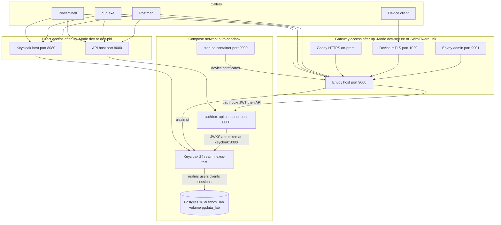

# Auth-in-a-Box — technical reference

Contracts for the product described in [USER-GUIDE.md](USER-GUIDE.md). The executable pass is [SCENARIO-TESTING.md](SCENARIO-TESTING.md).

The API prefix below is `/authbox/{tenant}/{instance}/api/v1`. The seeded path is `/authbox/default/default/api/v1`.


## Layout



Direct access is what you have after `.\devx\sandbox-ctl.ps1 up -Mode dev` or `up -Mode dev-pki`. Call the API on port 8000 and Keycloak on port 8080. Those modes also publish Envoy on port 9000. Gateway access is what you have after `up -Mode dev-secure`, or when you add `-WithFiwareLink`. Host ports 8000 and 8080 are unpublished. Callers use port 9000 for both Keycloak and the API.

Envoy forwards `/authbox/` to the API and `/realms/` to Keycloak. On `/authbox/`, `/orion/`, and `/iotagent/` Envoy checks the JWT before the API sees the call. A missing JWT is plain text `Jwt is missing`. A JSON `401` `{"detail":"Missing or invalid token"}` is the API. Keycloak `/admin/` is not routed. Use `kcadm.sh` inside `auth-sandbox-keycloak-1`.

On-prem, Caddy terminates HTTPS and forwards to Envoy. That stack uses database `authbox_production` and volume `pgdata_onprem`. Lab modes use `authbox_lab` on `pgdata_lab`, published on host port 5433. The API does not open a database connection. step-ca listens on port 9000 inside its container. That port is not host Envoy port 9000.

## Access paths

| Access | Keycloak base `$KC` | API base `$API` | Token issuer |
|---|---|---|---|
| Direct | `http://localhost:8080` | `http://localhost:8000` | `http://localhost:8080/realms/nexus-test` |
| Gateway | `http://localhost:9000` | `http://localhost:9000` | `http://localhost:9000/realms/nexus-test` |

| Mode | Access | Host ports |
|---|---|---|
| `base`, `min` | Direct | API `:8000`. Keycloak may use embedded H2 |
| `dev`, `dev-pki` | Direct, and Envoy `:9000` is also published | Keycloak `:8080`, API `:8000`, Postgres `:5433` |
| `dev-secure` | Gateway | `:9000`, Envoy admin `:9901`. Host `:8000` and `:8080` are unpublished |
| `dev-pki -WithFiwareLink` | Gateway | `:9000`, `:1029` device mTLS, `:8883`, `:9901` |
| on-prem | Caddy HTTPS, then Envoy | Database `authbox_production` |

Postgres host port on every lab mode is `5433`. Inside the compose network Keycloak uses `postgres:5432`.

## Claims

| Name | Where it lives | Value on this edition |
|---|---|---|
| `tid` | Access token | `tenant_a` for `testuser` and `nexus-m2m`. `tenant_b` for `tenant_b_user` |
| `tenant_id` | User attribute in Postgres | Same values as `tid`. It is not the access-token claim name |
| `roles` | Access token, password grant | Realm roles for that user. FIWARE `required_role` reads this claim |
| `realm_access.roles` | Access token | Keycloak's own role object |
| `clearance` | Access token, from the user attribute | `high` for `testuser`, `low` for `tenant_b_user` |
| `fiware_service`, `fiware_servicepath`, `fiware_tenant` | Access token, from user attributes | Present on `testuser` |

`GET .../verifier/evaluate` response fields:

| Field | Source |
|---|---|
| `status` | `success` when the token is accepted |
| `subject_id` | Token subject |
| `roles` | Token roles |
| `tenant_id` | `{tenant}` in the URL |
| `instance_id` | `{instance}` in the URL |

A token whose `tid` claim is empty is rejected with `401` and body `{"detail":"Missing or invalid token"}`.

## Callers

| Name | Secret or password | Grant | Realm roles |
|---|---|---|---|
| Client `nexus-sandbox` | `changeme` | Authorization code and password | — |
| Client `nexus-m2m` | `changeme` | Client credentials | service account |
| Client `iot-admin-app` | lab secret | Browser login | — |
| Client `nodered` | lab secret | Browser login | — |
| User `testuser` | `testpass` | Password | `admin`, `operator` |
| User `tenant_b_user` | `testpass` | Password | `viewer` |
| User `iot-operator` | `operator123` | Password | `operator` |
| User `iot-device` | `device123` | Password | `device` |
| Edge user `airuser` | none | `X-Username` on edge verify | manifest role `operator` |
| Edge user `airuser_protected` | `airpass` | `X-Username` and `X-Password` | manifest role `reader` |

Realm role names: `admin`, `operator`, `viewer`, `device`, `config_read`, `data_scientist`. `reader` is an edge-manifest role.

Keycloak admin on the lab is `admin` / `admin`, used from inside the Keycloak container. The gateway does not publish `/admin/`.

## Routes

| Method and path | Auth | Success |
|---|---|---|
| `GET /authbox/health` | none | `200` `{"status":"ok"}` |
| `GET /authbox/` | none on direct access | `200`, `version` `7.0.0` |
| `GET /openapi.json` | none on direct access | `200` OpenAPI document |
| `GET .../auth/authorize` | none | `200` `url`, `state`, `_sandbox_code_verifier`, `_sandbox_note` |
| `GET .../auth/callback?code=` | none | `200`, `next_step` contains `/auth/token` |
| `GET .../auth/callback` | none | `400` when `code` is absent |
| `GET .../auth/callback?error=access_denied` | none | `400`, detail contains `access_denied` |
| `POST .../auth/token` | form body | `200` `access_token`, `token_type` `Bearer` |
| `POST .../auth/token` with no `grant_type` | form body | `422` |
| `POST .../auth/token` `grant_type=authorization_code` and no `code` | form body | `400` |
| `GET .../verifier/evaluate` | `Authorization: Bearer` | `200` as in the claims table |
| `POST .../mfa/enroll` | Bearer | `200` `secret` |
| `POST .../mfa/challenge` | Bearer, form `secret` | `200` `code` |
| `POST .../mfa/verify` | Bearer, form `secret` and `verify_code` | `200` `valid` |
| `POST .../control/v1/mocks/generate-otp` | none, direct access | form `mode` of `generate`, `code`, or `verify` |
| `POST .../auth/edge/verify` | `X-Username`, optional `X-Password` | `200` `status` `success` |
| `POST .../auth/fiware/verify` | Bearer, optional correlation headers | `200` `status` `success` |
| `POST .../auth/iudx/verify` | Bearer, optional correlation headers | `200`, copies consent id and catalogue access |
| `POST .../auth/aadhaar/verify` | `X-Aadhaar-Xml` | `501` while no UIDAI key is configured |
| `POST .../auth/wallet/verify` | `X-Vp` | `200` for a presentation that includes `proof` |
| `POST .../mcp/validate` | Bearer | `200` `status` `success` |
| `GET .../mcp/config` | Bearer with `admin`, `operator`, or `config_read` | `200` for `testuser`, `403` for `tenant_b_user` |
| `POST /authbox/admin/v1/tenants` | Bearer | creates a URL tenant |
| `POST /authbox/admin/v1/tenants/{tenant}/instances` | Bearer | creates a URL instance |

The numbered pass in [SCENARIO-TESTING.md](SCENARIO-TESTING.md) calls every row above, and S-75 through S-85 call the routes in the next table.

| Method and path | Auth | Success body |
|---|---|---|
| `POST .../auth/token/revoke` | form `token`, `client_id`, `client_secret` | `status` `revoked`. Wrong client is `401`. Missing fields are `400` |
| `GET .../auth/m2m/ping` | Bearer | `status` `ok`. No bearer is `401` |
| `POST .../auth/device-trust/register` | Bearer with role `admin` or `operator` | JSON `device_id`, `trust_level`, `ttl_sec`. `ttl_sec` of 0 is `400` |
| `GET .../auth/device-trust/{device_id}` | Bearer with role `admin` or `operator` | `trust_level` |
| `POST .../auth/device-trust/suspend` | Bearer with role `admin` or `operator` | `trust_level` `suspended` |
| `POST .../auth/device-trust/revoke` | Bearer with role `admin` or `operator` | `trust_level` empty |
| `POST .../auth/fiware/device-anomaly` | Bearer with role `admin` or `operator` | JSON `action` of `suspend` or `revoke`. Any other action is `400` |

`required_role` is a query parameter on evaluate, edge verify, and FIWARE verify. The role must be on the token or the edge manifest. A missing role is `403` after the caller has been accepted. An unknown caller is `401`.

## FIWARE and IUDX headers

| Header | Effect |
|---|---|
| `Fiware-Service` | Copied as correlation on a successful FIWARE verify |
| `X-Fiware-Subject` | Correlation. It does not become `subject_id` |
| `X-Fiware-Roles` | Correlation. It does not satisfy `required_role` |
| `X-Iudx-Consent-Id` | Copied to `iudx_consent_id` after the bearer is accepted |
| `X-Iudx-Catalogue-Access` | Copied to `iudx_catalogue_access` after the bearer is accepted |
| `X-Consent-Artefact` | Ignored. It does not set `iudx_consent_id` |

The same `401` body is returned when those headers arrive without a bearer.

## Wallet and Aadhaar bodies

Aadhaar accepts header `X-Aadhaar-Xml`. Header `X-Aadhaar-Otp` alone returns `401`. XML while no UIDAI public key is configured returns `501`.

Wallet header `X-Vp` is a JSON verifiable presentation. These fields are required for `200`: `type` including `VerifiablePresentation`, `holder`, `verifiableCredential`, and `proof`. The response `subject_id` contains `did:key:`. The response `tenant_id` is the URL tenant (`default` on the seeded path). No wallet header returns `501`. Invalid JSON returns `400`. A presentation without `proof` returns `401`.

## Status codes

On direct access the API answers. On gateway access, Envoy's JWT filter runs first on `/authbox/`, `/orion/`, and `/iotagent/`.

| Path | Credential | Status | Body | Produced by |
|---|---|---|---|---|
| Routed and protected | none | `401` | `Jwt is missing` | Envoy |
| Routed and protected | bad signature or audience | `401` | `Jwt verification fails` | Envoy |
| Routed and protected | valid token, no such route | `404` | `{"detail":"Not Found"}` | API |
| Unrouted | none | `403` | `{"detail":"missing bearer token"}` | API ext-authz |
| Unrouted | token the API rejects | `401` | `{"detail":"Missing or invalid token"}` | API ext-authz |
| Unrouted | valid token | `404` | `Auth-Box gateway - use /authbox/, /realms/, /orion/, or /iotagent/` | Envoy |
| API, no bearer | none | `401` | `{"detail":"Missing or invalid token"}` | API |
| API, accepted caller, role missing | Bearer or edge user | `403` | forbidden | API |
| API, form missing `grant_type` | token form | `422` | validation error | API |
| API, authorization code grant with no `code` | form `grant_type=authorization_code` | `400` | `'code' is required` | API |

A plain-text `401` is Envoy. A JSON `401` is the API. The two `404` bodies distinguish an unrouted gateway path from a path that reached the API.

Gateway prefixes are `/authbox/`, `/realms/`, `/orion/`, and `/iotagent/`. Keycloak `/admin/` is not one of them. Admin commands run with `kcadm.sh` inside `auth-sandbox-keycloak-1`.

## Token endpoint forms

Password grant, sent to `$KC/realms/nexus-test/protocol/openid-connect/token`:

```text
grant_type=password&client_id=nexus-sandbox&client_secret=changeme&username=testuser&password=testpass
```

Client credentials, same URL:

```text
grant_type=client_credentials&client_id=nexus-m2m&client_secret=changeme
```

API token, `POST $API/authbox/default/default/api/v1/auth/token`:

| `grant_type` | Fields |
|---|---|
| `client_credentials` | `client_id`, `client_secret`. Omitted values use `nexus-sandbox` / `changeme` |
| `authorization_code` | `code`, `code_verifier`, `redirect_uri` |

## Environment on `authbox-api`

| Variable | Direct (`dev`) | Gateway (`dev-secure`) |
|---|---|---|
| `NEXUS_AUTH_ISSUER` | `http://localhost:8080/realms/nexus-test` | `http://localhost:9000/realms/nexus-test` |
| `NEXUS_AUTH_INTERNAL_ISSUER` | `http://keycloak:8080/realms/nexus-test` | same |
| `NEXUS_AUTH_FIWARE_JWKS_URL` | `http://keycloak:8080/realms/nexus-test/protocol/openid-connect/certs` | same |
| `NEXUS_AUTH_CLIENT_ID` | `nexus-sandbox` | same |
| `NEXUS_AUTH_CLIENT_SECRET` | `changeme` | same |
| `NEXUS_AUTH_AUDIENCE` | `account` | same |
| `NEXUS_AUTH_M2M_CLIENT_SECRET` | `changeme` | same |
| `NEXUS_AUTH_ALLOW_HTTP_SANDBOX` | `true` | `true` |
| `NEXUS_AUTH_ROLE_CLAIM` | `realm_access` | same |
| `NEXUS_SIMULATOR_TOTP_SECRET` | `JBSWY3DPEHPK3PXPJBSWY3DPEHPK3PXP` | same |
| `NEXUS_AUTH_CONTINUOUS_VERIFY` | `true` | same |
| `NEXUS_AUTH_SESSION_MAX_AGE_MINUTES` | `30` | same |

The tenant claim name the API reads is `tid`.

## Data and networks

| Item | Lab | On-prem |
|---|---|---|
| Database | `authbox_lab` | `authbox_production` |
| Volume | `pgdata_lab` | `pgdata_onprem` |
| User / password | `nexus` / `nexus_lab` | `nexus` / `nexus_prod` |
| Healthcheck | `pg_isready -U nexus -d authbox_lab` | `pg_isready` with `authbox_production` |

| Network | Who is on it |
|---|---|
| `public-net` | Postgres, Keycloak, API, Envoy |
| `auth-internal` | Keycloak, API, Envoy |
| `airgap-net` | API |

The API has no Postgres connection. Realms, users, clients, and sessions are Keycloak's tables. Audit goes to the API log and to `/var/log/authbox/sandbox.csv`. Continuous-verification session state is inside the API process. Session max age is 30 minutes.

## Where each thing is defined

| Thing | Defined in |
|---|---|
| Lab Postgres | `docker-compose.postgres-lab.yaml` |
| Keycloak, API, Envoy | `docker-compose.dev.yaml` |
| gateway access, hidden host ports | `docker-compose.dev.secure.yaml` |
| step-ca | `docker-compose.security.yaml` |
| `:1029` and `:8883` | `docker-compose.fiware-link.yaml` |
| On-prem and Caddy | `docker-compose.onprem.yaml`, `deploy/onprem/Caddyfile` |
| Realm, clients, users, mappers | `src/seed_data.py` |
| Startup and seed | `src/entrypoint.sh` |
| Routes | `src/routes/` |
| Gateway routes | `deploy/edge/envoy/envoy.yaml` |
| Edge manifest | `tests/assets` copied to `/app/tests/simulator/assets/discovery.json` |
| Bring-up | `devx/sandbox-ctl.ps1` |

A clone of this repository contains the rows above. `dist/` wheels and `deploy/edge/envoy/certs-lab/` are not in the clone. Building the image on that machine needs the wheels placed in `dist/` first, or an image that was already built.
