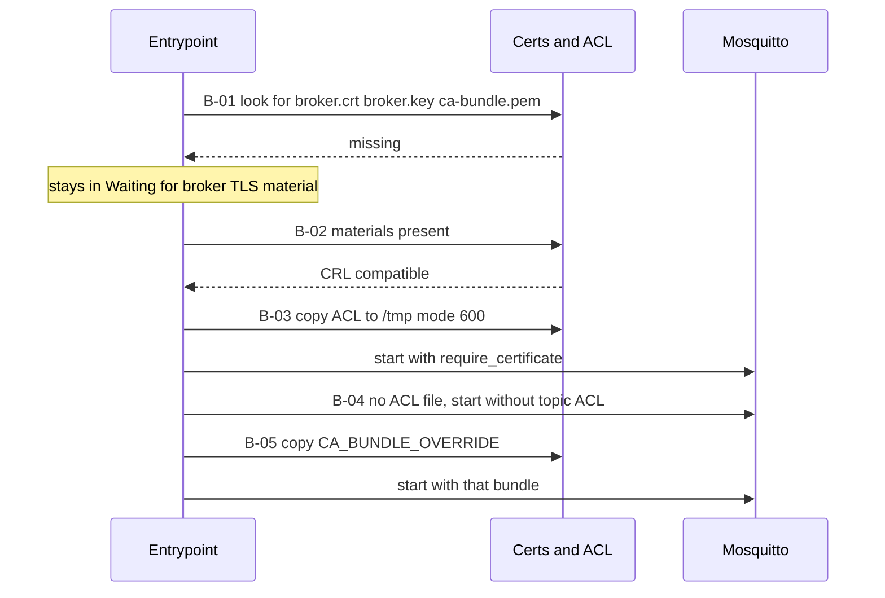
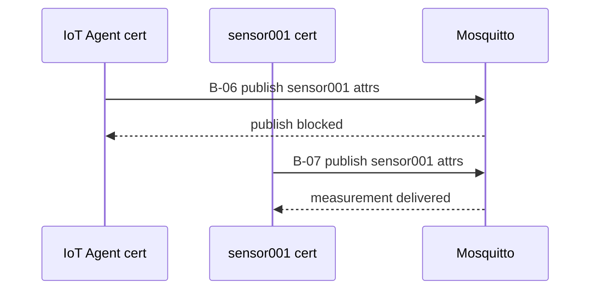
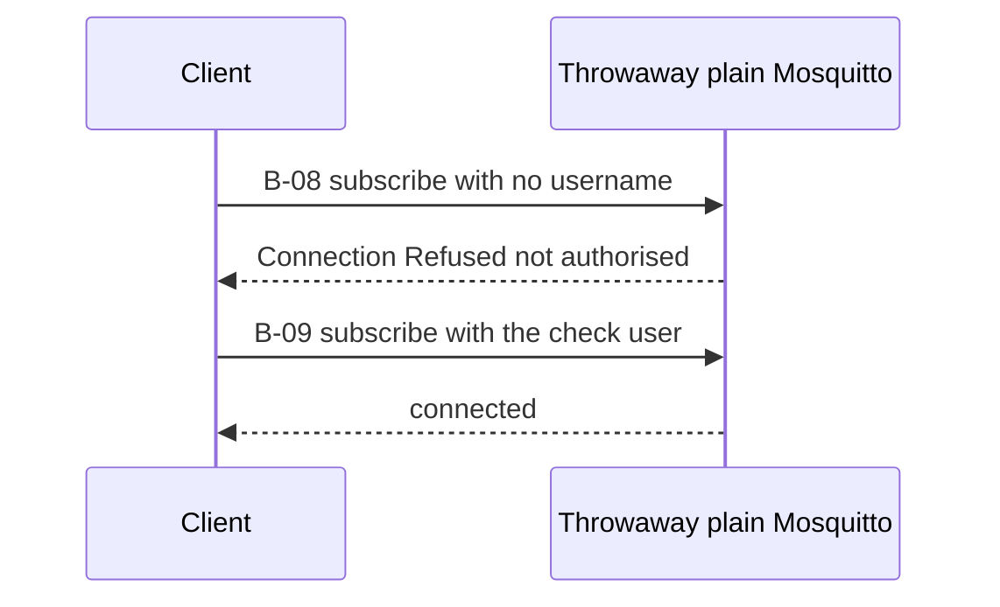
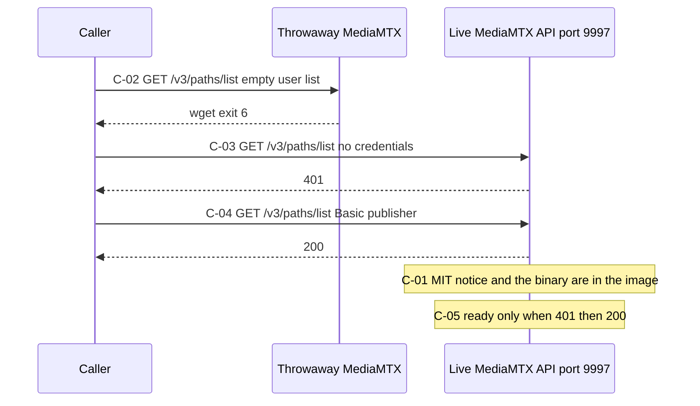
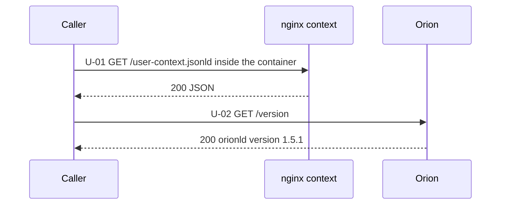
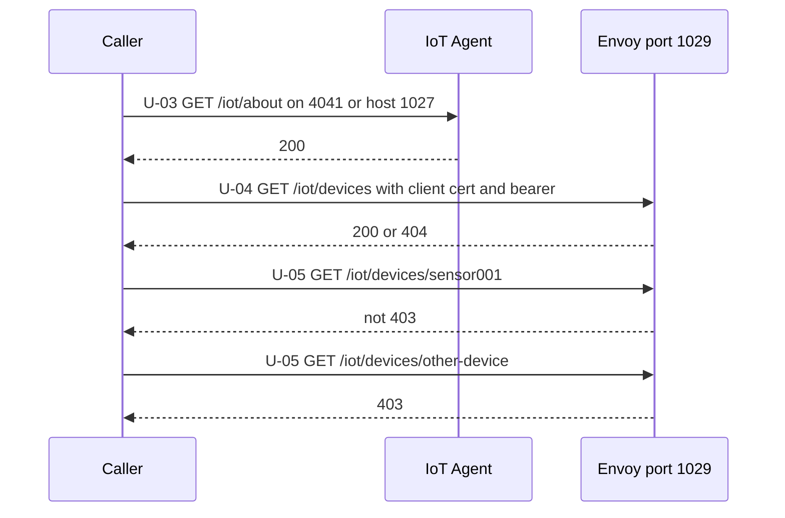
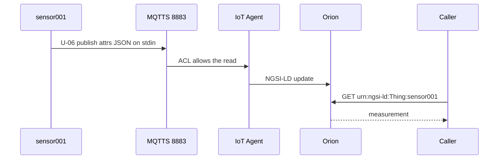
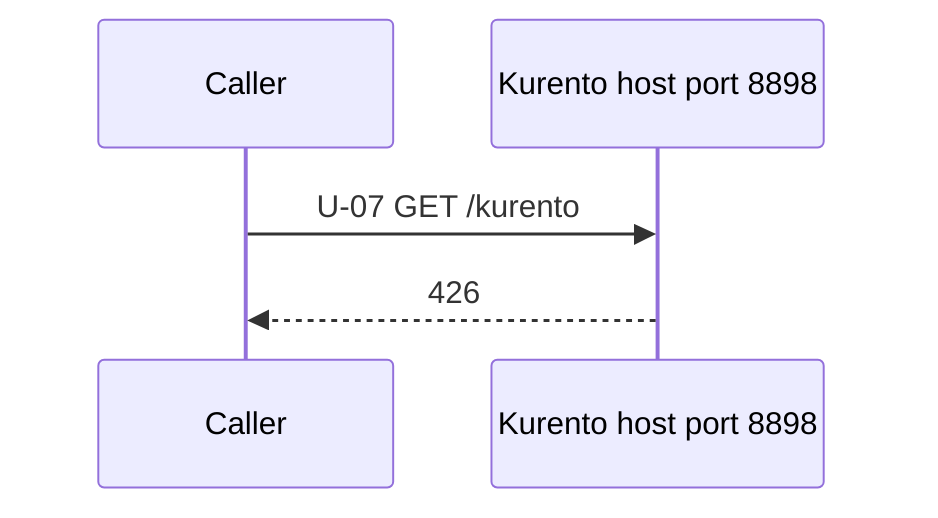

# FIWARE-Box — scenario pass

Each section is one flow: the diagram, then the same call in `curl.exe` and in Postman where the interface is HTTP, then the Windows PowerShell 5.1 or PowerShell 7 line that records `PASS`, `FAIL`, or `SKIP`. The PowerShell line prints the observed value and does not print a password.

Set how you started first. Service background is [USER-GUIDE.md](USER-GUIDE.md). Contracts are [TECHNICAL-REFERENCE.md](TECHNICAL-REFERENCE.md). This edition is [RELEASE-NOTES.md](RELEASE-NOTES.md).

In PowerShell, `curl` is an alias for `Invoke-WebRequest`. The REST lines use `curl.exe`.

## Contents

| Section | Scenarios |
|---|---|
| [Prerequisites](#prerequisites) | What must be running, how to start it, paste order |
| [Setup](#setup) | How you started, helpers |
| [Device broker entrypoint](#device-broker-entrypoint) | B-01 to B-05 |
| [Device broker ACL](#device-broker-acl) | B-06 to B-07 |
| [Plain MQTT listener](#plain-mqtt-listener) | B-08 to B-09 |
| [Camera gateway](#camera-gateway) | C-01 to C-05 |
| [Context and Orion](#context-and-orion) | U-01 to U-02 |
| [IoT Agent and device API](#iot-agent-and-device-api) | U-03 to U-05 |
| [Measurement](#measurement) | U-06 |
| [Kurento](#kurento) | U-07 |
| [Results](#results) | the table |
| [Scenario index](#scenario-index) | B-01 through U-07 |

## Prerequisites

The blocks on this page do not start the stack. They record a pass against containers that are already running. Paste them in one Windows PowerShell 5.1 or 7 window, in the order below. A block pasted into a new window has no `$How`, no `$Token`, and no result list. Which start is the lab drill and which is the production-shaped deployment, and how Node-RED or an RTSP publisher lines up with these ids, is [USER-GUIDE.md](USER-GUIDE.md) section 15.

### What must already be running

The default value is `$How = "linked-mtls-media"`. Before the first block, `docker ps` shows these containers up:

| Container | Used by |
|---|---|
| `auth-sandbox-envoy-1` on `9000`, `1029`, and `8883` | U-02, U-03, U-04, U-05, U-06 read-back |
| `fiware-box-mosquitto-1` | B-02, B-03, B-04, B-05, B-06, B-07, U-04, U-05, U-06 |
| `fiware-box-orion-1`, `fiware-box-iot-agent-1`, `fiware-box-mongo-1` | U-02, U-03, U-06 |
| `fiware-box-context-1` | U-01 |
| `fiware-box-mediamtx-1` on `9997` | C-03, C-04, C-05 |

Images that must already exist, because a check starts a container from them:

| Image | Used by |
|---|---|
| `fiware-box/mosquitto-mtls:local` | B-01, and the live device broker |
| `fiware-box/mediamtx:1.9.3-wget` | C-01, C-02, and the live camera gateway |
| `eclipse-mosquitto:2` digest `sha256:6f8d8a947c506f8a2290ec65cd4bd2bc7cb4d43fb5f6271f861cb013e2ef9797` | B-08, B-09. The block starts it and removes it |
| `kurento/kurento-media-server:7.0.0` | U-07. The block starts it and removes it |

Set these in that same window before the block that reads them. This page does not contain the values.

| Name | Read by |
|---|---|
| `AUTHBOX_CLIENT_SECRET`, `AUTHBOX_IOT_PASSWORD` | `Get-LabToken`, then U-02 through U-06 |
| `FIWARE_API_KEY` | B-06, B-07, U-06 |
| `MEDIAMTX_PUBLISH_PASSWORD` | C-04, C-05 |

Auth-Box must currently list the CN `sensor001`. A `403` body `device identity 'sensor001' not in trust registry` means that list does not contain it. The certificate files at `/mosquitto/certs` inside `fiware-box-mosquitto-1` must still be inside their 24 hours.

```text
docker ps --format "{{.Names}} {{.Status}}"
```

### If those containers are not running

This page does not start them. The containers named above are already running before any block is pasted. Device certificates are already mounted and still inside 24 hours. Auth-Box currently lists CN `sensor001`.

`dev` is a different set of containers: Orion on `1026`, the IoT Agent on `1027`, and plain MQTT on `1883`, with no Auth-Box. After that set is what `docker ps` shows, paste `$How = "dev"` and do not paste `$How = "linked-mtls-media"`. `media-kurento` is also a different set. B-08, B-09, and U-07 do not need that change. Each one starts a short-lived container of its own.

### Paste order in the one window

1. Exactly one `$How` line. The default is `linked-mtls-media`.
2. The address line that sets `$ORION` and `$IOTA`.
3. `$Results` and `Add-Check`.
4. `Get-LabToken`, then `Get-DeviceApiCode`, when `$How` is not `dev`.
5. B-01 through U-07 in the order on this page.
6. The Results block.

Pasting the other `$How` line later changes `$ORION` and `$IOTA` for every block after it. C-05 reads the C-03 and C-04 rows already stored in `$Results`. Pasting C-05 before those two records a failure. A failed id is pasted again in this same window, after Setup. A new window does not have the helpers.

### What each scenario borrows

| Id | Running beforehand | Borrowed from earlier blocks | Container this block starts |
|---|---|---|---|
| B-01 | Image `fiware-box/mosquitto-mtls:local` | `Add-Check` | `mosq-b01`, then removed |
| B-02, B-03 | `fiware-box-mosquitto-1` | `Add-Check` | None |
| B-04 | Certificate files in the live broker | `Add-Check` | `mosq-b04`, then removed |
| B-05 | `ca-bundle-break-glass.pem` in the live broker | `Add-Check` | `mosq-b05`, then removed. `SKIP` when the file is absent |
| B-06, B-07 | Live broker, device certificates, `FIWARE_API_KEY` | `Add-Check` | None |
| B-08, B-09 | Pinned plain Mosquitto image | `Add-Check` | `mosq-b08`, then removed |
| C-01, C-02 | Camera image | `Add-Check` | C-02 starts `mtx-c02`, then removes it |
| C-03 | `fiware-box-mediamtx-1` | `Add-Check` | None |
| C-04 | `fiware-box-mediamtx-1`, `MEDIAMTX_PUBLISH_PASSWORD` | `Add-Check` | None. `SKIP` when the password is empty |
| C-05 | C-03 and C-04 already recorded | Those two rows in `$Results` | None |
| U-01 | `fiware-box-context-1` | `Add-Check` | None |
| U-02 | Orion at `$ORION`. On a linked start, `$Token` | `$How`, `$ORION`, `$Token` | None. `SKIP` when the linked token is empty |
| U-03 | IoT Agent at `$IOTA`. On a linked start, `$Token` | `$How`, `$IOTA`, `$Token` | None. `SKIP` when the linked token is empty |
| U-04, U-05 | Auth-Box `:1029`, `sensor001` certificate, CN listed | `Get-DeviceApiCode`, `$Token` | None. `SKIP` on `dev` or when `$Token` is empty |
| U-06 | Live broker, `FIWARE_API_KEY`, Orion. On a linked start, `$Token` | `$How`, `$ORION`, `$Token` | None |
| U-07 | `kurento/kurento-media-server:7.0.0` can be run | `Add-Check` | `kurento-u07`, then removed |
| Results | The blocks above | Every row in `$Results` | None |

## Setup

How you started the device broker and the camera gateway together. The containers are already running. [Prerequisites](#prerequisites) is the start command when they are not, and the paste order for this page.

```powershell
$How = "linked-mtls-media"
```

That means Auth-Box is already up, `fiware-box-mosquitto-1` is the device-broker image, and `fiware-box-mediamtx-1` is answering on port `9997`. U-02, U-03, U-04, U-05, and the U-06 read-back call that Auth-Box install. U-04 and U-05 also need the certificate CN listed there. A `403` body `device identity 'sensor001' not in trust registry` means the list does not contain it. B-08 and B-09 start the pinned plain Mosquitto image. U-07 starts `kurento/kurento-media-server:7.0.0`. The full list is [USER-GUIDE.md](USER-GUIDE.md) section 12.

How you started the plain listener instead. This is the internal lab drill. Auth-Box is not used. Orion is on `1026`, the IoT Agent is on `1027`, and plain MQTT is on `1883`.

```powershell
$How = "dev"
```

That means Orion answers on port `1026`, the IoT Agent answers on port `1027`, and `fiware-box-mosquitto-1` is the plain MQTT listener on port `1883`.

Addresses that follow from `$How`:

```powershell
if ($How -eq "dev") { $ORION = "http://localhost:1026"; $IOTA = "http://localhost:1027" } else { $ORION = "http://localhost:9000/orion"; $IOTA = "http://localhost:9000/iotagent" }
```

```powershell
$Results = New-Object System.Collections.Generic.List[object]; function Add-Check([string]$Id, [string]$Result) { $Results.Add([pscustomobject]@{ Id = $Id; Result = $Result }) | Out-Null }
```

Postman environment for this session:

| Variable | After `up -Mode dev` | After `up -Mode linked-mtls-media` |
|---|---|---|
| `orion` | `http://localhost:1026` | `http://localhost:9000/orion` |
| `iota` | `http://localhost:1027` | `http://localhost:9000/iotagent` |
| `mediamtx` | unset | `http://localhost:9997` |
| `gateway` | unset | `http://localhost:9000` |
| `devices` | unset | `https://localhost:1029` |
| `token` | unset | access token from `{{gateway}}/realms/nexus-test` |

`MEDIAMTX_PUBLISH_PASSWORD`, `AUTHBOX_CLIENT_SECRET`, `AUTHBOX_IOT_PASSWORD`, and `FIWARE_API_KEY` stay in the environment. The lines below read them and do not print them. This pack does not contain those values.

Mint a token for a linked start. The call is `POST http://localhost:9000/realms/nexus-test/protocol/openid-connect/token` with `Content-Type: application/x-www-form-urlencoded`.

| Field | Value |
|---|---|
| `grant_type` | `password` |
| `client_id` | `nexus-sandbox` |
| `username` | `iot-operator`, or `AUTHBOX_IOT_USERNAME` when that variable is set |
| `client_secret` | `AUTHBOX_CLIENT_SECRET` |
| `password` | `AUTHBOX_IOT_PASSWORD` |

curl.exe, with the two secrets left as placeholders. Do not substitute them on the command line:

```text
curl.exe -sS -X POST "http://localhost:9000/realms/nexus-test/protocol/openid-connect/token" -H "Content-Type: application/x-www-form-urlencoded" -d "grant_type=password" -d "client_id=nexus-sandbox" -d "username=iot-operator" -d "client_secret=<AUTHBOX_CLIENT_SECRET>" -d "password=<AUTHBOX_IOT_PASSWORD>"
```

Postman: `POST {{gateway}}/realms/nexus-test/protocol/openid-connect/token`, body type `x-www-form-urlencoded`, the same five fields. Store `client_secret` and `password` as secret variables in the Postman environment.

The recorded line keeps both secrets inside the process and stores only the access token in `$Token`. It does not print the token.

```powershell
function Get-LabToken {
    if (-not $env:AUTHBOX_CLIENT_SECRET -or -not $env:AUTHBOX_IOT_PASSWORD) { return $null }
    $body = @{
        grant_type    = "password"
        client_id     = "nexus-sandbox"
        client_secret = $env:AUTHBOX_CLIENT_SECRET
        username      = $(if ($env:AUTHBOX_IOT_USERNAME) { $env:AUTHBOX_IOT_USERNAME } else { "iot-operator" })
        password      = $env:AUTHBOX_IOT_PASSWORD
    }
    return (Invoke-RestMethod -Method Post -Uri "http://localhost:9000/realms/nexus-test/protocol/openid-connect/token" -ContentType "application/x-www-form-urlencoded" -Body $body).access_token
}
$Token = Get-LabToken
```

Port `1029` is reached with `curl` inside the broker container. That `curl` can read the PEM files at `/mosquitto/certs`. Windows `curl.exe --cert` cannot. The token is passed by name (`-e FIWARE_MTLS_TOKEN`) and is not written on the command line.

```powershell
function Get-DeviceApiCode([string]$Path) {
    $env:FIWARE_MTLS_TOKEN = $Token
    $env:FIWARE_MTLS_PATH = $Path
    $sh = Join-Path $env:TEMP "fiware-1029.sh"
    $utf8 = New-Object System.Text.UTF8Encoding $false
    $body = @'
curl -sk -o /dev/null -w "%{http_code}" --cert /mosquitto/certs/sensor001.crt --key /mosquitto/certs/sensor001.key -H "Authorization: Bearer $FIWARE_MTLS_TOKEN" -H "Fiware-Service: openiot" -H "Fiware-Servicepath: /" "https://host.docker.internal:1029${FIWARE_MTLS_PATH}"
'@
    [System.IO.File]::WriteAllText($sh, ($body -replace "`r", ""), $utf8)
    docker cp $sh "fiware-box-mosquitto-1:/tmp/fiware-1029.sh"
    Remove-Item $sh
    $code = docker exec -e FIWARE_MTLS_TOKEN -e FIWARE_MTLS_PATH fiware-box-mosquitto-1 sh /tmp/fiware-1029.sh
    Remove-Item Env:FIWARE_MTLS_TOKEN, Env:FIWARE_MTLS_PATH -ErrorAction SilentlyContinue
    return "$code".Trim()
}
```

U-02 and U-03 use `$Token` when `$How` is not `dev`.

## Device broker entrypoint

How you started: any mode that runs `fiware-box/mosquitto-mtls:local` (`mtls`, `linked-mtls`, or `linked-mtls-media`). Paste Setup first. B-02 and B-03 read the live broker. B-04 and B-05 copy certificate files out of that broker. B-01 only needs the image, and it removes `mosq-b01` when it finishes.

The entrypoint waits for broker certificates, accepts a compatible CRL, installs the ACL, and can point the trust bundle at the break-glass file.



These checks are `docker` logs, not HTTP. There is no `curl.exe` or Postman call for B-01 through B-05.

**B-01.** With no broker certificate mounted, the entrypoint waits and Mosquitto does not start.

```powershell
docker rm -f mosq-b01 2>$null | Out-Null; docker run -d --name mosq-b01 fiware-box/mosquitto-mtls:local | Out-Null; Start-Sleep -Seconds 3; $log = docker logs mosq-b01 2>&1 | Out-String; docker rm -f mosq-b01 | Out-Null; $waiting = $log -match "Waiting for broker TLS material"; $started = $log -match "Starting mosquitto"; "waiting=$waiting started=$started"; Add-Check "B-01" $(if ($waiting -and -not $started) { "PASS" } else { "FAIL" })
```

> ```
> waiting=True started=False
> ```

**B-02.** On the live broker, the runtime config requires a certificate and enables the CRL.

```powershell
$cfg = docker exec fiware-box-mosquitto-1 sh -c "grep -E 'require_certificate|crlfile' /tmp/mosquitto-runtime.conf"; $cfg; Add-Check "B-02" $(if ($cfg -match "require_certificate true" -and $cfg -match "crlfile") { "PASS" } else { "FAIL" })
```

> ```
> require_certificate true
> crlfile /tmp/crl.pem
> ```

**B-03.** The ACL file in the live container is mode `600`.

```powershell
$mode = docker exec fiware-box-mosquitto-1 stat -c %a /tmp/mosquitto-acl.conf; $mode; Add-Check "B-03" $(if ($mode.Trim() -eq "600") { "PASS" } else { "FAIL" })
```

> ```
> 600
> ```

**B-04.** When the ACL file is not mounted, the entrypoint starts Mosquitto and logs that there is no topic ACL. The listener text below is the whole config this check needs. The certificate files are copied out of the already running broker. Nothing is read from a repository path.

```powershell
$work = Join-Path $env:TEMP "fiware-b04"; if (Test-Path $work) { Remove-Item -Recurse -Force $work }; New-Item -ItemType Directory -Path (Join-Path $work "certs") | Out-Null; $utf8 = New-Object System.Text.UTF8Encoding $false; [System.IO.File]::WriteAllText((Join-Path $work "mosquitto.conf"), "listener 8883`ncafile /mosquitto/certs/ca-bundle.pem`ncertfile /mosquitto/certs/broker.crt`nkeyfile /mosquitto/certs/broker.key`nrequire_certificate true`nuse_identity_as_username true`nallow_anonymous false`npersistence true`npersistence_location /mosquitto/data/`nlog_dest stdout`nacl_file /mosquitto/config/mosquitto-acl.conf`n", $utf8); $copied = $true; foreach ($n in @("broker.crt","broker.key","ca-bundle.pem")) { docker cp "fiware-box-mosquitto-1:/mosquitto/certs/$n" (Join-Path $work "certs\$n"); if ($LASTEXITCODE -ne 0) { $copied = $false } }; if (-not $copied) { Add-Check "B-04" "FAIL" } else { docker rm -f mosq-b04 2>$null | Out-Null; docker run -d --name mosq-b04 -v "${work}/mosquitto.conf:/mosquitto/config/mosquitto.conf:ro" -v "${work}/certs:/mosquitto/certs:ro" fiware-box/mosquitto-mtls:local | Out-Null; Start-Sleep -Seconds 5; $log = docker logs mosq-b04 2>&1 | Out-String; docker rm -f mosq-b04 | Out-Null; Remove-Item -Recurse -Force $work; $log -match "No ACL file"; Add-Check "B-04" $(if ($log -match "No ACL file" -and $log -match "Starting mosquitto") { "PASS" } else { "FAIL" }) }
```

> ```
> True
> ```

The log line is `No ACL file — broker runs without topic ACL`.

**B-05.** `CA_BUNDLE_OVERRIDE` pointing at `ca-bundle-break-glass.pem` is copied in, and Mosquitto starts. The certificate files are copied out of the already running broker into a temporary directory, so the live mount is not rewritten. `SKIP` when that broker does not contain `ca-bundle-break-glass.pem`.

```powershell
$bg = Join-Path $env:TEMP "fiware-b05"; if (Test-Path $bg) { Remove-Item -Recurse -Force $bg }; New-Item -ItemType Directory -Path (Join-Path $bg "certs") | Out-Null; $utf8 = New-Object System.Text.UTF8Encoding $false; [System.IO.File]::WriteAllText((Join-Path $bg "mosquitto.conf"), "listener 8883`ncafile /mosquitto/certs/ca-bundle.pem`ncertfile /mosquitto/certs/broker.crt`nkeyfile /mosquitto/certs/broker.key`nrequire_certificate true`nuse_identity_as_username true`nallow_anonymous false`npersistence true`npersistence_location /mosquitto/data/`nlog_dest stdout`nacl_file /mosquitto/config/mosquitto-acl.conf`n", $utf8); [System.IO.File]::WriteAllText((Join-Path $bg "mosquitto-acl.conf"), "user iotagent`ntopic read `$SYS/broker/version`ntopic read /+/+/attrs`ntopic write /+/+/cmd`npattern write /+/%u/attrs`npattern read /+/%u/cmd`n", $utf8); $copied = $true; foreach ($n in @("broker.crt","broker.key","ca-bundle.pem","ca-bundle-break-glass.pem")) { docker cp "fiware-box-mosquitto-1:/mosquitto/certs/$n" (Join-Path $bg "certs\$n"); if ($LASTEXITCODE -ne 0) { $copied = $false } }; if (-not $copied) { Remove-Item -Recurse -Force $bg; Add-Check "B-05" "SKIP" } else { docker rm -f mosq-b05 2>$null | Out-Null; docker run -d --name mosq-b05 -e CA_BUNDLE_OVERRIDE=/mosquitto/certs/ca-bundle-break-glass.pem -v "${bg}/certs:/mosquitto/certs" -v "${bg}/mosquitto.conf:/mosquitto/config/mosquitto.conf:ro" -v "${bg}/mosquitto-acl.conf:/mosquitto/config/mosquitto-acl.conf:ro" fiware-box/mosquitto-mtls:local | Out-Null; Start-Sleep -Seconds 5; $log = docker logs mosq-b05 2>&1 | Out-String; docker rm -f mosq-b05 | Out-Null; Remove-Item -Recurse -Force $bg; $log -match "dual-trust"; Add-Check "B-05" $(if ($log -match "Using dual-trust CA bundle" -and $log -match "Starting mosquitto") { "PASS" } else { "FAIL" }) }
```

> ```
> True
> ```

## Device broker ACL

How you started: `linked-mtls-media` or another mode whose Mosquitto container is `fiware-box/mosquitto-mtls:local`. The certificate files are already mounted at `/mosquitto/certs` inside that container. Set `FIWARE_API_KEY` in this window before B-06. B-07 uses the same broker and the same key.

The IoT Agent certificate may read device `attrs` topics and may not write them. The device certificate may write only the topic whose device segment equals its CN.



Not HTTP. No `curl.exe` or Postman column. The topic is `/$FIWARE_API_KEY/sensor001/attrs` inside the container. The shell file is written as UTF-8 with no byte-order mark and copied in with `docker cp`. The key is passed with `-e FIWARE_API_KEY` and does not appear on the command line. `SKIP` when `FIWARE_API_KEY` is empty. The allow payload is `{"t": 26, "h": 60}` on stdin. Do not use `mosquitto_pub -m`. Do not pipe the script into `docker exec` from Windows PowerShell.

**B-06.** The IoT Agent certificate cannot publish `sensor001` attrs.

```powershell
if (-not $env:FIWARE_API_KEY) { Add-Check "B-06" "SKIP" } else {
    $sh = Join-Path $env:TEMP "fiware-b06.sh"
    $utf8 = New-Object System.Text.UTF8Encoding $false
    $body = @'
set -eu
topic="/${FIWARE_API_KEY}/sensor001/attrs"
mosquitto_sub -h 127.0.0.1 -p 8883 --cafile /mosquitto/certs/ca-bundle.pem --cert /mosquitto/certs/sensor001.crt --key /mosquitto/certs/sensor001.key -t "$topic" -C 1 -W 3 >/tmp/b06-sub.txt 2>/tmp/b06-sub.err &
sub=$!
sleep 1
printf '%s\n' '{"t":1}' | mosquitto_pub -h 127.0.0.1 -p 8883 --cafile /mosquitto/certs/ca-bundle.pem --cert /mosquitto/certs/iotagent.crt --key /mosquitto/certs/iotagent.key -t "$topic" -s || true
if wait "$sub"; then echo "unauthorized publish delivered"; exit 1; fi
echo "unauthorized publish blocked"
'@
    [System.IO.File]::WriteAllText($sh, ($body -replace "`r", ""), $utf8)
    docker cp $sh "fiware-box-mosquitto-1:/tmp/b06.sh"
    Remove-Item $sh
    $out = docker exec -e FIWARE_API_KEY fiware-box-mosquitto-1 sh /tmp/b06.sh
    $out
    Add-Check "B-06" $(if ($LASTEXITCODE -eq 0 -and ("$out" -match "blocked")) { "PASS" } else { "FAIL" })
}
```

> ```
> unauthorized publish blocked
> ```

**B-07.** The `sensor001` certificate publishes `{"t": 26, "h": 60}`.

```powershell
if (-not $env:FIWARE_API_KEY) { Add-Check "B-07" "SKIP" } else {
    $sh = Join-Path $env:TEMP "fiware-b07.sh"
    $utf8 = New-Object System.Text.UTF8Encoding $false
    $body = @'
set -eu
topic="/${FIWARE_API_KEY}/sensor001/attrs"
mosquitto_sub -h 127.0.0.1 -p 8883 --cafile /mosquitto/certs/ca-bundle.pem --cert /mosquitto/certs/iotagent.crt --key /mosquitto/certs/iotagent.key -t "$topic" -C 1 -W 5 >/tmp/b07-msg.txt &
sub=$!
sleep 1
printf '%s\n' '{"t":26,"h":60}' | mosquitto_pub -h 127.0.0.1 -p 8883 --cafile /mosquitto/certs/ca-bundle.pem --cert /mosquitto/certs/sensor001.crt --key /mosquitto/certs/sensor001.key -t "$topic" -s
wait "$sub"
cat /tmp/b07-msg.txt
'@
    [System.IO.File]::WriteAllText($sh, ($body -replace "`r", ""), $utf8)
    docker cp $sh "fiware-box-mosquitto-1:/tmp/b07.sh"
    Remove-Item $sh
    $out = docker exec -e FIWARE_API_KEY fiware-box-mosquitto-1 sh /tmp/b07.sh
    $out
    Add-Check "B-07" $(if ($LASTEXITCODE -eq 0 -and ("$out" -match '"t"')) { "PASS" } else { "FAIL" })
}
```

> ```
> {"t": 26, "h": 60}
> ```

## Plain MQTT listener

This check starts a short-lived container from the pinned plain image `eclipse-mosquitto:2@sha256:6f8d8a947c506f8a2290ec65cd4bd2bc7cb4d43fb5f6271f861cb013e2ef9797`. It is not `fiware-box/mosquitto-mtls:local`, and it does not replace the live device broker. Host port `11883` is only this throwaway. Paste Setup first so `Add-Check` exists. A pass here does not stand in for B-01 through B-07, and those earlier blocks do not have to be `PASS` before this one.

Anonymous clients are refused. The username is `FIWARE_MQTT_USER` when that variable is set, otherwise `probeuser`. The password is `FIWARE_MQTT_PASSWORD` when that variable is set. Otherwise the check creates a one-time password, keeps it in the environment, and removes it when the container is removed. The password is not printed.



Not HTTP.

**B-08 and B-09.** No username, then the check user. The client runs inside the throwaway container, on container port `1883`.

```powershell
$user = $(if ($env:FIWARE_MQTT_USER) { $env:FIWARE_MQTT_USER } else { "probeuser" })
$env:PLAIN_CHECK_USER = $user
if ($env:FIWARE_MQTT_PASSWORD) { $env:PLAIN_CHECK_PASSWORD = $env:FIWARE_MQTT_PASSWORD } else {
    $chars = [char[]]((48..57) + (65..90) + (97..122))
    $env:PLAIN_CHECK_PASSWORD = -join (1..16 | ForEach-Object { $chars | Get-Random })
}
$work = Join-Path $env:TEMP "fiware-b08"
if (Test-Path $work) { Remove-Item -Recurse -Force $work }
New-Item -ItemType Directory -Path $work | Out-Null
$utf8 = New-Object System.Text.UTF8Encoding $false
$start = @'
set -eu
mosquitto_passwd -b -c /tmp/pw "$PLAIN_CHECK_USER" "$PLAIN_CHECK_PASSWORD"
chown mosquitto:mosquitto /tmp/pw
chmod 600 /tmp/pw
printf '%s\n' "listener 1883" "allow_anonymous false" "password_file /tmp/pw" > /tmp/mosquitto.conf
exec mosquitto -c /tmp/mosquitto.conf
'@
$sub = @'
set -eu
mosquitto_sub -h 127.0.0.1 -p 1883 -u "$PLAIN_CHECK_USER" -P "$PLAIN_CHECK_PASSWORD" -t '$SYS/broker/version' -C 1 -W 3
'@
[System.IO.File]::WriteAllText((Join-Path $work "start.sh"), ($start -replace "`r", ""), $utf8)
[System.IO.File]::WriteAllText((Join-Path $work "b09.sh"), ($sub -replace "`r", ""), $utf8)
$image = "eclipse-mosquitto:2@sha256:6f8d8a947c506f8a2290ec65cd4bd2bc7cb4d43fb5f6271f861cb013e2ef9797"
docker rm -f mosq-b08 2>$null | Out-Null
docker run -d --name mosq-b08 --entrypoint sh -e PLAIN_CHECK_USER -e PLAIN_CHECK_PASSWORD -p 127.0.0.1:11883:1883 -v "${work}/start.sh:/start.sh:ro" $image /start.sh | Out-Null
Start-Sleep -Seconds 3
$anon = docker exec mosq-b08 mosquitto_sub -h 127.0.0.1 -p 1883 -t '$SYS/broker/version' -C 1 -W 2 2>&1 | Out-String
$anonExit = $LASTEXITCODE
$anon
Add-Check "B-08" $(if ($anonExit -ne 0 -and $anon -match "not authorised") { "PASS" } else { "FAIL" })
docker cp (Join-Path $work "b09.sh") "mosq-b08:/tmp/b09.sh" | Out-Null
$auth = docker exec -e PLAIN_CHECK_USER -e PLAIN_CHECK_PASSWORD mosq-b08 sh /tmp/b09.sh 2>&1 | Out-String
$authExit = $LASTEXITCODE
$log = docker logs mosq-b08 2>&1 | Out-String
$auth
"user_in_log=$($log -match [regex]::Escape("u'$user'"))"
Add-Check "B-09" $(if ($authExit -eq 0 -and $log -match [regex]::Escape("u'$user'")) { "PASS" } else { "FAIL" })
docker rm -f mosq-b08 | Out-Null
Remove-Item -Recurse -Force $work
Remove-Item Env:PLAIN_CHECK_PASSWORD -ErrorAction SilentlyContinue
Remove-Item Env:PLAIN_CHECK_USER -ErrorAction SilentlyContinue
```

The anonymous client prints:

> ```
> Connection error: Connection Refused: not authorised
> ```

## Camera gateway

How you started: `up -Mode linked-mtls-media` with `MEDIAMTX_PUBLISH_PASSWORD` set. The image is `fiware-box/mediamtx:1.9.3-wget`. C-01 and C-02 use that image. C-03 and C-04 call the live container on `9997`. Paste C-05 only after C-03 and C-04 have stored a row in `$Results`.

An empty user list rejects every API caller. The live process rejects a call with no credentials and accepts the named publisher.



| Id | curl.exe | Postman |
|---|---|---|
| C-03 | `curl.exe -sS -o NUL -w "%{http_code}" http://127.0.0.1:9997/v3/paths/list` | `GET {{mediamtx}}/v3/paths/list` with no Authorization |
| C-04 | `curl.exe -sS -o NUL -w "%{http_code}" --basic -u "$env:MEDIAMTX_PUBLISH_USER" http://127.0.0.1:9997/v3/paths/list` | `GET {{mediamtx}}/v3/paths/list`, Basic Auth, username `publisher`, password from the environment |

`curl.exe` prompts for the C-04 password when you run the table line at a keyboard. Do not put the password on the command line. The recorded line writes a curl config file in UTF-8 with no byte-order mark, passes that file to `curl.exe --config`, prints only the status code, and deletes the file. Windows PowerShell piping a string into `curl.exe` or `docker exec` inserts a byte-order mark and the call fails.

**C-01.** The image contains the MIT copyright line and `/mediamtx`.

```powershell
$text = docker run --rm --entrypoint sh fiware-box/mediamtx:1.9.3-wget -c "sed -n '1,3p' /licenses/mediamtx-MIT.txt; test -x /mediamtx && echo binary=ok"; $text; Add-Check "C-01" $(if ($text -match "Copyright \(c\) 2019 aler9" -and $text -match "binary=ok") { "PASS" } else { "FAIL" })
```

> ```
> MIT License
> Copyright (c) 2019 aler9
> binary=ok
> ```

**C-02.** A throwaway container started from the empty user list below rejects the API. Host port `19997` avoids the live API on `9997`. The config is written here. It is not read from a repository path.

```powershell
$work = Join-Path $env:TEMP "fiware-c02"; if (Test-Path $work) { Remove-Item -Recurse -Force $work }; New-Item -ItemType Directory -Path $work | Out-Null; $utf8 = New-Object System.Text.UTF8Encoding $false; [System.IO.File]::WriteAllText((Join-Path $work "mediamtx.yml"), "logLevel: info`napi: yes`napiAddress: :9997`nauthMethod: internal`nauthInternalUsers: []`npaths:`n  all_others:`n", $utf8); docker rm -f mtx-c02 2>$null | Out-Null; docker run -d --name mtx-c02 -p 127.0.0.1:19997:9997 -v "${work}/mediamtx.yml:/mediamtx.yml:ro" fiware-box/mediamtx:1.9.3-wget /mediamtx.yml | Out-Null; Start-Sleep -Seconds 2; docker exec mtx-c02 wget -q -O /dev/null http://127.0.0.1:9997/v3/paths/list; $code = $LASTEXITCODE; docker rm -f mtx-c02 | Out-Null; Remove-Item -Recurse -Force $work; "wget_exit=$code"; Add-Check "C-02" $(if ($code -eq 6) { "PASS" } else { "FAIL" })
```

> ```
> wget_exit=6
> ```

wget exit `6` is an authentication failure.

**C-03.** The live API with no credentials.

```powershell
$code = curl.exe -sS -o NUL -w "%{http_code}" http://127.0.0.1:9997/v3/paths/list; $code; Add-Check "C-03" $(if ($code -eq "401") { "PASS" } else { "FAIL" })
```

> ```
> 401
> ```

**C-04.** The live API as the publisher. The password stays in the environment. `curl.exe` reads it from standard input and prints only the status code.

```powershell
if (-not $env:MEDIAMTX_PUBLISH_PASSWORD) { Add-Check "C-04" "SKIP" } else {
    $user = $(if ($env:MEDIAMTX_PUBLISH_USER) { $env:MEDIAMTX_PUBLISH_USER } else { "publisher" })
    $cfg = Join-Path $env:TEMP "fiware-c04.txt"
    $utf8 = New-Object System.Text.UTF8Encoding $false
    [System.IO.File]::WriteAllText($cfg, "user = `"$user`:$($env:MEDIAMTX_PUBLISH_PASSWORD)`"`n", $utf8)
    $code = curl.exe -sS -o NUL -w "%{http_code}" --config $cfg --basic "http://127.0.0.1:9997/v3/paths/list"
    Remove-Item $cfg -Force
    $code
    Add-Check "C-04" $(if ("$code".Trim() -eq "200") { "PASS" } else { "FAIL" })
}
```

> ```
> 200
> ```

**C-05.** Readiness is C-03 plus C-04. An anonymous `200` is `FAIL`.

```powershell
$open = @($Results | Where-Object Id -eq "C-03" | Select-Object -Last 1).Result; $auth = @($Results | Where-Object Id -eq "C-04" | Select-Object -Last 1).Result; Add-Check "C-05" $(if ($open -eq "PASS" -and $auth -eq "PASS") { "PASS" } elseif ($auth -eq "SKIP") { "SKIP" } else { "FAIL" })
```

## Context and Orion

How you started: any mode. The context container has no host port, so U-01 is `docker exec` into `fiware-box-context-1`. U-02 uses `$ORION` from Setup: port `1026` after `dev`, port `9000` after a linked start. On a linked start, paste `Get-LabToken` first. An empty `$Token` records `SKIP`.



| Id | curl.exe | Postman |
|---|---|---|
| U-01 | No host port. Use the PowerShell `docker exec` line | No host URL |
| U-02 | `curl.exe -sS "$ORION/version"` | `GET {{orion}}/version`. After a linked start, header `Authorization: Bearer {{token}}` |

**U-01.** Context document.

```powershell
$hdr = docker exec fiware-box-context-1 wget -S -O - http://127.0.0.1/user-context.jsonld 2>&1 | Out-String; $hdr -match "HTTP/1.1 200"; Add-Check "U-01" $(if ($hdr -match "HTTP/1.1 200" -and $hdr -match "@context") { "PASS" } else { "FAIL" })
```

> ```
> True
> ```

**U-02.** Orion version. On a linked start this needs a bearer token. `SKIP` when that secret is unset.

```powershell
if ($How -ne "dev" -and -not $Token) { Add-Check "U-02" "SKIP" } else { $params = @{ Uri = "$ORION/version" }; if ($How -ne "dev") { $params.Headers = @{ Authorization = "Bearer $Token" } }; $r = Invoke-RestMethod @params; $r.'orionld version'; Add-Check "U-02" $(if ($r.'orionld version' -eq "1.5.1") { "PASS" } else { "FAIL" }) }
```

> ```
> 1.5.1
> ```

After a linked start the same request sends `Authorization: Bearer $Token`. `SKIP` when `$Token` is empty.

## IoT Agent and device API

How you started: `dev` uses host port `1027`. A linked start uses port `9000` for `GET`, and port `1029` for the certificate check. Inside the compose network the agent is `iot-agent:4041`. U-03 uses `$IOTA` and `$Token` from Setup. U-04 and U-05 call `Get-DeviceApiCode`, so that function has to be pasted first, and Auth-Box must currently list `sensor001`.



| Id | curl.exe | Postman |
|---|---|---|
| U-03 | `curl.exe -sS -H "Fiware-Service: openiot" "$IOTA/iot/about"` | `GET {{iota}}/iot/about`, header `Fiware-Service: openiot` |
| U-04 | Windows `curl.exe --cert` cannot load a PEM file. The recorded line runs `curl` inside `fiware-box-mosquitto-1` | `GET https://localhost:1029/iot/devices` with the `sensor001` client certificate and `Authorization: Bearer {{token}}` |
| U-05 | Same recorded line, two paths | `GET https://localhost:1029/iot/devices/sensor001`, then `GET https://localhost:1029/iot/devices/other-device` |

**U-03.** About, on the address selected in Setup. Linked `GET` on port `9000` needs the bearer token.

```powershell
if ($How -ne "dev" -and -not $Token) { Add-Check "U-03" "SKIP" } else { $hdr = @{ "Fiware-Service" = "openiot" }; if ($How -ne "dev") { $hdr.Authorization = "Bearer $Token" }; $r = Invoke-WebRequest -Uri "$IOTA/iot/about" -Headers $hdr -UseBasicParsing; $r.StatusCode; Add-Check "U-03" $(if ($r.StatusCode -eq 200) { "PASS" } else { "FAIL" }) }
```

> ```
> 200
> ```

**U-04.** Device list on port `1029`. This call goes to the Auth-Box install. `SKIP` on a `dev` start or when `$Token` is empty. Pass is `200` or `404`. A body `device identity 'sensor001' not in trust registry` means Auth-Box does not currently list that CN.

```powershell
if ($How -eq "dev" -or -not $Token) { Add-Check "U-04" "SKIP" } else { $code = Get-DeviceApiCode "/iot/devices"; $code; Add-Check "U-04" $(if ($code -eq "200" -or $code -eq "404") { "PASS" } else { "FAIL" }) }
```

**U-05.** CN match and mismatch. The matching path is `/iot/devices/sensor001`. The mismatch path is `/iot/devices/other-device`.

```powershell
if ($How -eq "dev" -or -not $Token) { Add-Check "U-05" "SKIP" } else { $match = Get-DeviceApiCode "/iot/devices/sensor001"; $bad = Get-DeviceApiCode "/iot/devices/other-device"; "sensor001=$match other-device=$bad"; Add-Check "U-05" $(if ($match -ne "403" -and $bad -eq "403") { "PASS" } else { "FAIL" }) }
```

## Measurement

How you started: `mtls`, `linked-mtls`, or `linked-mtls-media`, with device certificates enrolled. The device publishes MQTTS. Orion then shows the measurement. Set `FIWARE_API_KEY` first. On a linked start, `$Token` from `Get-LabToken` is what the read-back sends. B-06 and B-07 do not have to have passed before this block.



The publish itself is MQTT. The read-back is HTTP.

| Id | curl.exe | Postman |
|---|---|---|
| U-06 read-back | `curl.exe -sS -H "Fiware-Service: openiot" -H "NGSILD-Tenant: openiot" -H "Authorization: Bearer <token>" "$ORION/ngsi-ld/v1/entities/urn:ngsi-ld:Thing:sensor001"` | `GET {{orion}}/ngsi-ld/v1/entities/urn:ngsi-ld:Thing:sensor001` with `Fiware-Service: openiot`, `NGSILD-Tenant: openiot`, and the bearer token |

Do not pass the measurement with `mosquitto_pub -m`. The recorded line sends the JSON on stdin. Do not put `<token>` on a `curl.exe` command line. The read-back uses `$Token` inside `Invoke-RestMethod` and does not print it. On a `dev` start, `$Token` is empty and `$ORION` is port `1026`, so the read-back has no bearer header. `SKIP` when `FIWARE_API_KEY` is empty, and on a linked start when `$Token` is empty.

**U-06.** Publish and read back.

```powershell
if (-not $env:FIWARE_API_KEY -or ($How -ne "dev" -and -not $Token)) { Add-Check "U-06" "SKIP" } else {
    $env:FIWARE_MEAS_T = "$(Get-Random -Minimum 100 -Maximum 999)"
    $sh = Join-Path $env:TEMP "fiware-u06.sh"
    $utf8 = New-Object System.Text.UTF8Encoding $false
    $body = @'
set -eu
topic="/${FIWARE_API_KEY}/sensor001/attrs"
printf '%s\n' "{\"t\":${FIWARE_MEAS_T},\"h\":60}" | mosquitto_pub -h 127.0.0.1 -p 8883 --cafile /mosquitto/certs/ca-bundle.pem --cert /mosquitto/certs/sensor001.crt --key /mosquitto/certs/sensor001.key -t "$topic" -s
'@
    [System.IO.File]::WriteAllText($sh, ($body -replace "`r", ""), $utf8)
    docker cp $sh "fiware-box-mosquitto-1:/tmp/fiware-u06.sh"
    Remove-Item $sh
    docker exec -e FIWARE_API_KEY -e FIWARE_MEAS_T fiware-box-mosquitto-1 sh /tmp/fiware-u06.sh
    if ($LASTEXITCODE -ne 0) { Add-Check "U-06" "FAIL" } else {
        $hdr = @{ "Fiware-Service" = "openiot"; "NGSILD-Tenant" = "openiot" }
        if ($Token) { $hdr.Authorization = "Bearer $Token" }
        $seen = $false
        $deadline = (Get-Date).AddSeconds(30)
        while ((Get-Date) -lt $deadline) {
            try {
                $ent = Invoke-RestMethod -Uri "$ORION/ngsi-ld/v1/entities/urn:ngsi-ld:Thing:sensor001" -Headers $hdr -TimeoutSec 5
                if ($ent.t.value -eq [int]$env:FIWARE_MEAS_T -or $ent.temperature.value -eq [int]$env:FIWARE_MEAS_T) { $seen = $true; break }
            } catch { }
            Start-Sleep -Seconds 2
        }
        Remove-Item Env:FIWARE_MEAS_T
        "landed=$seen"
        Add-Check "U-06" $(if ($seen) { "PASS" } else { "FAIL" })
    }
}
```

## Kurento

U-07 starts `kurento/kurento-media-server:7.0.0` on `127.0.0.1:8898` when that port is not already answering, then removes the container it started. Leave the camera lab on `linked-mtls-media`. This block does not read earlier scenario rows, other than `Add-Check` from Setup. A subscriber keeps its own history. This pack does not start QuantumLeap or Crate.



| Id | curl.exe | Postman |
|---|---|---|
| U-07 | `curl.exe -sS -o NUL -w "%{http_code}" http://127.0.0.1:8898/kurento` | `GET http://127.0.0.1:8898/kurento` |

**U-07.** `426` is healthy. Container port `8888` is published as host port `8898`.

```powershell
$code = "$(curl.exe -sS -o NUL -w "%{http_code}" --max-time 3 http://127.0.0.1:8898/kurento 2>$null)".Trim()
$started = $false
if ($code -ne "426" -and $code -ne "200") {
    docker rm -f kurento-u07 2>$null | Out-Null
    docker run -d --name kurento-u07 -p 127.0.0.1:8898:8888 kurento/kurento-media-server:7.0.0 | Out-Null
    $started = $true
    $deadline = (Get-Date).AddSeconds(90)
    do {
        Start-Sleep -Seconds 2
        $code = "$(curl.exe -sS -o NUL -w "%{http_code}" --max-time 3 http://127.0.0.1:8898/kurento 2>$null)".Trim()
    } while ((Get-Date) -lt $deadline -and $code -ne "426" -and $code -ne "200")
}
$code
Add-Check "U-07" $(if ($code -eq "426" -or $code -eq "200") { "PASS" } else { "FAIL" })
if ($started) { docker rm -f kurento-u07 | Out-Null }
```

> ```
> 426
> ```

## Results

```powershell
$Results | Format-Table -AutoSize; "PASS=$((@($Results | Where-Object Result -eq 'PASS')).Count) FAIL=$((@($Results | Where-Object Result -eq 'FAIL')).Count) SKIP=$((@($Results | Where-Object Result -eq 'SKIP')).Count)"
```

Paste this block last, in the same window. On a `linked-mtls-media` start, set `AUTHBOX_CLIENT_SECRET`, `AUTHBOX_IOT_PASSWORD`, `FIWARE_API_KEY`, and `MEDIAMTX_PUBLISH_PASSWORD` before Setup. U-02, U-03, U-04, U-05, and U-06 are `SKIP` when `$Token` is empty. B-06, B-07, and U-06 are `SKIP` when `FIWARE_API_KEY` is empty. B-05 is `SKIP` when the running broker has no `ca-bundle-break-glass.pem`. A `FAIL` id is pasted again in this same window. A new window does not have `$Results` or the helpers.

## Scenario index

| Id | What it checks |
|---|---|
| B-01 | Device broker waits when broker certificates are missing |
| B-02 | `require_certificate` and `crlfile` are in the runtime config |
| B-03 | ACL file mode `600` |
| B-04 | No ACL file, broker still starts |
| B-05 | Break-glass CA bundle is applied |
| B-06 | IoT Agent certificate cannot publish `sensor001` attrs |
| B-07 | `sensor001` measurement is delivered |
| B-08 | Plain MQTT with no username is refused |
| B-09 | Plain MQTT user from the environment connects |
| C-01 | Camera image contains the MIT notice and `/mediamtx` |
| C-02 | Empty MediaMTX user list rejects the API |
| C-03 | Live MediaMTX API with no credentials is `401` |
| C-04 | Live MediaMTX API as the publisher is `200` |
| C-05 | Readiness is C-03 and C-04 |
| U-01 | Context document is `200` |
| U-02 | Orion version is `1.5.1` |
| U-03 | IoT Agent `/iot/about` is `200` |
| U-04 | Port `1029` device list is `200` or `404` |
| U-05 | Matching CN is not `403`. `other-device` is `403` |
| U-06 | MQTTS measurement is visible in Orion |
| U-07 | Kurento `GET /kurento` is `426` |
