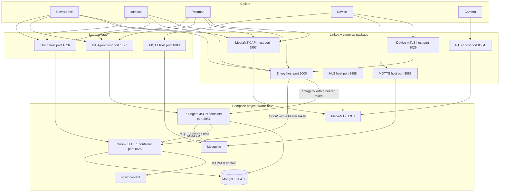

# FIWARE-Box — technical reference

Contracts for the product described in [USER-GUIDE.md](USER-GUIDE.md). The executable pass is [SCENARIO-TESTING.md](SCENARIO-TESTING.md). This edition is [RELEASE-NOTES.md](RELEASE-NOTES.md).

## Layout

Which **package** is running decides which host port is published. Chooser: [README.md](README.md). The containers are the same compose project, `fiware-box`.

On **Lab**, which does not use Auth-Box, call Orion on port `1026` and the IoT Agent on port `1027`. Port `1027` is a host map onto container port `4041`. Plain MQTT is port `1883`. Those three ports are the Lab drill. A Lab video option keeps them and adds the camera ports. **mTLS data-plane** keeps `1026` and `1027`, does not publish `1883`, and adds MQTTS on `8883` when the certificate files are already mounted.

On **Linked edge** or **Linked + cameras** (Auth-Box already up), host ports `1026`, `1027`, and `1883` are not published. Call Orion at `http://localhost:9000/orion` and the IoT Agent at `http://localhost:9000/iotagent`. Both require a bearer token. Devices call `https://localhost:1029` with a client certificate, and MQTTS on `localhost:8883`. Linked + cameras also publishes MediaMTX on `9997`, `8554`, and `8888`.

Inside the compose network the context document is `http://context/user-context.jsonld`. The context container has no host port. Read it with `docker exec` into `fiware-box-context-1`.

**Options (not packages):** **Kurento** (host `8898`; `GET /kurento` → `426`; U-07 throwaway or workshop). **Node-RED** (`:1880` provision UI). **ffmpeg / RTSP** to MediaMTX `:8554` (operator machine). QuantumLeap / Crate are out of this pack. A Kurento workshop topology is a different set of containers from Linked + cameras.

## Access paths

| Package | Auth-Box | Orion base | IoT Agent base | MQTT / video |
|---|---|---|---|---|
| Lab | Not used | `http://localhost:1026` | `http://localhost:1027` | Plain `1883` |
| mTLS data-plane | Not at request time. Certs mounted | `http://localhost:1026` | `http://localhost:1027` | MQTTS `8883` when free |
| Linked edge | Already running | `http://localhost:9000/orion` | `http://localhost:9000/iotagent` | `8883` through Auth-Box |
| Linked + cameras | Already running | `http://localhost:9000/orion` | `http://localhost:9000/iotagent` | `8883` through Auth-Box; MediaMTX `9997`, `8554`, `8888` |

Lab mode name aliases (`dev`, `mtls`, `linked-mtls`, `linked-mtls-media`, …) are in [USER-GUIDE.md](USER-GUIDE.md) [§10.4](USER-GUIDE.md#104-lab-mode-name-aliases-footnote).

| Header | Value on this pack |
|---|---|
| `Fiware-Service` | `openiot` |
| `Fiware-ServicePath` | `/` |
| `Content-Type` | `application/json` for the IoT Agent, `application/ld+json` for Orion |
| `Link` | `<http://context/user-context.jsonld>; rel="http://www.w3.org/ns/json-ld#context"; type="application/ld+json"` |

A call on port `9000` also sends `Authorization: Bearer <token>`. Mint the token from `http://localhost:9000/realms/nexus-test`.

## Identity

The certificate CN, the MQTT topic device segment, the Mosquitto ACL user, and the IoT Agent `device_id` are the same string.

| Name | Value |
|---|---|
| Lab tenant | `openiot` |
| API key in the topic | The value of `FIWARE_API_KEY`. It is not printed in this pack |
| Measurement device | `sensor001` |
| Camera device | `camera001`, entity type `VisionNode` |
| Camera command | `pullConfig` |
| Topic shape | `/{apikey}/{deviceId}/{intent}` |

Intents:

| Intent | Who writes | Who reads |
|---|---|---|
| `attrs` | The device whose CN is `{deviceId}` | `iotagent` |
| `cmd` | `iotagent` | That device |
| `cmdexe` | That device | `iotagent` |
| `configuration/commands` | `iotagent` writes the command | That device reads it |

`iotagent` cannot publish `/{apikey}/sensor001/attrs`. `sensor001` can.

## Routes

Host access on **Lab** (and mTLS data-plane for Orion / IoT Agent). On Linked packages, replace the host with port `9000` and the path prefix `/orion` or `/iotagent`, and add the bearer token.

| Method and path | Who answers | Result |
|---|---|---|
| `GET /version` | Orion | `200`, `orionld version` `1.5.1` |
| `GET /ngsi-ld/v1/entities/{id}` | Orion | The entity, or `404` |
| `GET /ngsi-ld/v1/subscriptions` | Orion | The subscription list |
| `GET /iot/about` | IoT Agent | `200` |
| `GET /iot/devices` | IoT Agent | The device list for the tenant |
| `GET /iot/devices/{id}` | IoT Agent | That device |
| `POST /iot/services` | IoT Agent | Creates a service group |
| `POST /iot/devices` | IoT Agent | Creates a device |
| `GET /user-context.jsonld` | Context container, port 80 inside the network | `200` JSON |
| `GET /v3/paths/list` on port `9997` | MediaMTX | `401` with no credentials. `200` as the publisher |
| `GET /iot/devices` on `https://localhost:1029` | Auth-Box, client certificate plus bearer token | `200` or `404` |
| `GET /kurento` on port `8898` | Kurento option or scenario U-07 | `426` |
| RTSP publish to port `8554` path `live` | MediaMTX, publisher credentials | The path is listed by `GET /v3/paths/list` on `9997` |

`PATCH` sent to port `9000` returns `405`. A command is a `GET` of the entity on port `9000`, then an NGSI-LD `PATCH` to the IoT Agent on container port `4041`. The IoT Agent publishes `/{apikey}/{deviceId}/cmd`.

Service groups on this stack:

| Entity type | Resource | API key |
|---|---|---|
| `Thing` | `/iot/d` | `FIWARE_API_KEY` |
| `VisionNode` | `/iot/vision` | `FIWARE_API_KEY` |

Without the `VisionNode` group, the IoT Agent publishes commands on `/1234/{deviceId}/cmd`.

## Status codes

| Code | Where | Meaning |
|---|---|---|
| `200` | Orion, IoT Agent, MediaMTX with publisher auth, context document | The call was accepted |
| `201` | `POST /iot/devices` or `POST /iot/services` | Created |
| `401` | MediaMTX with no credentials, or port `9000` with a missing or rejected token | Credentials required |
| `403` | Port `1029` when the certificate CN does not match the device id in the path | The certificate was accepted and the path was rejected |
| `403` | Port `1029` with body `device identity '<cn>' not in trust registry` | Auth-Box does not currently list that CN. The list lasts 24 hours in the Auth-Box API process |
| `404` | Unknown entity or device. On port `1029`, also a reachable listener with nothing at that id | The listener answered |
| `405` | `PATCH` on port `9000` | That method is not routed on the gateway |
| `426` | `GET :8898/kurento` | The WebSocket listener is up |

Ready for an HTTP check is `200`–`299`, or `426` for Kurento. An anonymous `200` from MediaMTX is not ready.

## Ports

| Port | When it is published | What answers |
|---|---|---|
| `1026` | Lab, mTLS data-plane (and Lab video / Node-RED / Kurento workshop options) | Orion |
| `1027` | Those same packages / options | Host map onto IoT Agent `4041` |
| `7896` | Lab | IoT Agent HTTP southbound |
| `1883` | Lab (and Lab options that keep plain MQTT). Not on mTLS data-plane or Linked | Plain MQTT with username and password |
| `8883` | mTLS data-plane when free. On Linked packages this port belongs to Auth-Box | MQTTS |
| `9000` | Auth-Box | Token and gateway |
| `1029` | Auth-Box, Linked packages | Device mTLS API |
| `9997` | Linked + cameras (or a Lab video option) | MediaMTX API |
| `8554` | Those camera surfaces | RTSP |
| `8888` | Those camera surfaces | HLS |
| `8889` | Those camera surfaces | WebRTC |
| `8898` | Kurento option / U-07 | Kurento |

## Files the running containers already have

The checks that need a throwaway copy write it in [SCENARIO-TESTING.md](SCENARIO-TESTING.md).

| What the container is using | In this pack | Contents |
|---|---|---|
| Plain MQTT listener | No | `allow_anonymous false`, password file `/tmp/mosquitto.passwd` |
| Plain MQTT password file | No | Hash of `FIWARE_MQTT_USER` and `FIWARE_MQTT_PASSWORD` |
| mTLS listener | No | Listener `8883`, `require_certificate`, `use_identity_as_username` |
| ACL file | No | Copied to `/tmp/mosquitto-acl.conf` mode `600` |
| Camera configuration | No | One named publisher. An empty user list grants nobody |
| `.env` | No | Not used. Values come from the environment |

The plain broker copies the hash to `/tmp/mosquitto.passwd`, sets owner `1883`, and sets mode `600` before Mosquitto starts. mTLS data-plane and Linked packages require a client certificate on listener `8883` and start `/entrypoint.sh`. Solo `docker run` of either leaf is unsupported ([README.md](README.md)).

## Images and license notices

| Image | Notice in the image |
|---|---|
| `fiware-box/mosquitto-mtls:local` | `/licenses/NOTICE`. Eclipse Mosquitto terms are unchanged |
| `fiware-box/mediamtx:1.9.3-wget` | `/licenses/mediamtx-MIT.txt` and `/licenses/NOTICE` |
| `nginx:1.31.6-alpine` | Upstream nginx terms |
| `fiware/orion-ld:1.5.1` | Upstream terms |
| `fiware/iotagent-json:3.14.0` | Upstream terms |
| `mongo:4.4.30` | Upstream terms. The image is digest-pinned |
| `kurento/kurento-media-server:7.0.0` | Upstream terms. Kurento option and scenario U-07 |

Node-RED is a workshop option on port `1880`. It is not one of the two leaves in this pack. Leaves and GHCR stamps: [RELEASE-NOTES.md](RELEASE-NOTES.md).

MongoDB is queried with the `mongo` shell, not `mongosh`. Orion-LD stores the `openiot` tenant in database `orion-openiot`. Database `orion` is the default tenant and is empty until that tenant is used. The IoT Agent registry is database `iotagentjson`, collections `groups`, `devices`, and `commands`.

## Where you see each behavior

This pack describes containers that are already running. It does not name the files that built them. Operate them with the calls in [USER-GUIDE.md](USER-GUIDE.md) and [SCENARIO-TESTING.md](SCENARIO-TESTING.md).

| Behavior | Where you see it |
|---|---|
| Which containers are up | `docker ps`, names `fiware-box-<service>-1` |
| Plain listener | Anonymous client refused on `1883`. Named user connects |
| mTLS listener and ACL | Certificate required on `8883`. B-06 and B-07 |
| Camera gateway | `GET http://127.0.0.1:9997/v3/paths/list` |
| Device broker entrypoint | `docker logs fiware-box-mosquitto-1` and `/entrypoint.sh` inside that image |
