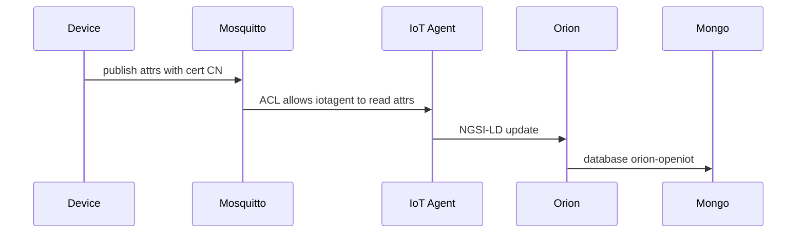
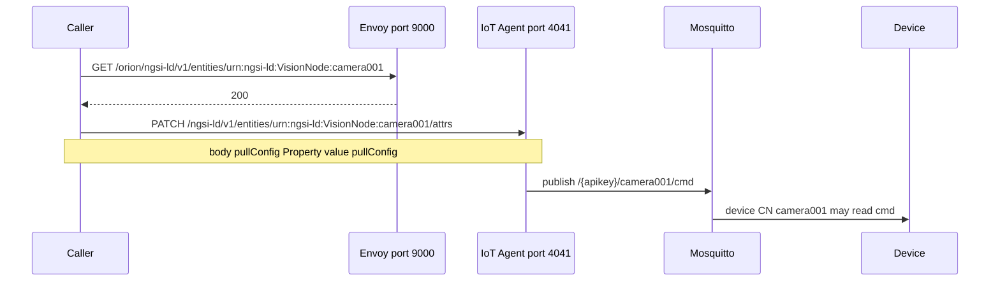

# FIWARE-Box — every service, explained

What each container is, what it gives you, and the call that operates it.

HTTP calls are shown three ways: `curl.exe`, Postman, and PowerShell. In PowerShell, `curl` is an alias for `Invoke-WebRequest`. Use `curl.exe` when you want the curl binary. MQTT is not HTTP. Those tasks use `mosquitto_sub` and `mosquitto_pub`.

Plain blocks are what you run. A quoted block under them is the response you should get back.

How you started decides the address. See [How you started](#10-modes-and-how-you-started). Contracts are in [TECHNICAL-REFERENCE.md](TECHNICAL-REFERENCE.md). The numbered pass is in [SCENARIO-TESTING.md](SCENARIO-TESTING.md). This edition is in [RELEASE-NOTES.md](RELEASE-NOTES.md).

## Calling the API

After a `dev` start, Orion is on port `1026` and the IoT Agent is on port `1027`:

```powershell
$ORION = "http://localhost:1026"
$IOTA = "http://localhost:1027"
```

After Auth-Box is already up and this stack was started as `linked-mtls` or `linked-mtls-media`:

```powershell
$ORION = "http://localhost:9000/orion"
$IOTA = "http://localhost:9000/iotagent"
```

Shared values:

```powershell
$Tenant = "openiot"
$ApiKey = $env:FIWARE_API_KEY
$h = @{ "Fiware-Service" = $Tenant; "Fiware-ServicePath" = "/"; "Content-Type" = "application/json" }
$ctx = '<http://context/user-context.jsonld>; rel="http://www.w3.org/ns/json-ld#context"; type="application/ld+json"'
```

`FIWARE_API_KEY` is set by the operator. This pack does not contain that value. Leave `$ApiKey` empty in a recorded session rather than pasting a key into the page.

On port `9000`, add a bearer token to `$h`. Mint it with `POST http://localhost:9000/realms/nexus-test/protocol/openid-connect/token` and `Content-Type: application/x-www-form-urlencoded`. The fields are `grant_type=password`, `client_id=nexus-sandbox`, `username` `iot-operator` (or `AUTHBOX_IOT_USERNAME`), `client_secret` from `AUTHBOX_CLIENT_SECRET`, and `password` from `AUTHBOX_IOT_PASSWORD`. Do not put those two values on a `curl.exe` command line and do not print the token. The recorded call is `Get-LabToken` in [SCENARIO-TESTING.md](SCENARIO-TESTING.md).

Postman environment:

| Variable | After `up -Mode dev` | After a linked start |
|---|---|---|
| `orion` | `http://localhost:1026` | `http://localhost:9000/orion` |
| `iota` | `http://localhost:1027` | `http://localhost:9000/iotagent` |
| `mediamtx` | unset | `http://localhost:9997` |
| `token` | unset | access token from port `9000` |

## Contents

### Part I — The services

| Service | What you can do there |
|---|---|
| [1. MongoDB](#1-mongodb) | Find the tenant database and the device registry |
| [2. Orion-LD](#2-orion-ld) | Read version and entities |
| [3. Context server](#3-context-server) | Read the JSON-LD context document |
| [4. Mosquitto](#4-mosquitto) | Publish a measurement, refuse an anonymous client, enforce the ACL |
| [5. IoT Agent JSON](#5-iot-agent-json) | List devices, provision a service group |
| [6. MediaMTX](#6-mediamtx) | Reject an open API call, accept the publisher |
| [7. Kurento](#7-kurento) | Confirm the WebSocket listener |
| [8. Your listener](#8-your-listener) | Read Orion or MQTT and keep your own history |
| [9. Node-RED](#9-node-red) | Provision a device in the browser and publish a measurement |

### Part II — The platform

| Section | Covers |
|---|---|
| [10. Modes and how you started](#10-modes-and-how-you-started) | What must be running, and the start command when it is not |
| [11. How the services fit together](#11-how-the-services-fit-together) | Measurement path and command path |
| [12. When the stack is linked to Auth-Box](#12-when-the-stack-is-linked-to-auth-box) | Which scenarios call Auth-Box, and the other pieces a check uses |
| [13. Cross-service reference](#13-cross-service-reference) | Names, ports, health |
| [14. End-to-end verification](#14-end-to-end-verification) | One pass over the data plane |
| [15. Lab testing and production deployment](#15-lab-testing-and-production-deployment) | Lab drill, linked deployment, Node-RED, and an RTSP publisher |
| [Appendix A. Where you see it](#appendix-a-where-you-see-it) | Running containers and the checks |

Compose project name is `fiware-box`. Container names are `fiware-box-<service>-1`.

# Part I — The services

## 1. MongoDB

### 1.1 What it is

`mongo:4.4.30`, the store for Orion-LD and the IoT Agent. Orion-LD keeps one database per tenant, named `orion-<tenant>`. This lab uses tenant `openiot`, so entities are in `orion-openiot`. Database `orion` is the default tenant. Querying `orion` and getting no entities means you opened the wrong database.

Orion-LD `1.5.1` uses the `mongo` shell. The commands below use `mongo`, not `mongosh`.

### 1.2 What it provides

- NGSI-LD entities, subscriptions, and context-source registrations, per tenant.
- The IoT Agent service groups, devices, and in-flight commands.
- A cache of downloaded JSON-LD `@context` documents.
- The `mongo_data` volume. `down` keeps it. `down-v` removes it.

### 1.3 What you can achieve

| Goal | Task |
|---|---|
| Find where entities live | [1.5.1 List the databases](#151-list-the-databases) |
| See what the IoT Agent has provisioned | [1.5.2 Inspect the device registry](#152-inspect-the-device-registry) |

### 1.4 Configuration

The service has no host port in a linked start. After `up -Mode dev`, compose publishes a host port only when `MONGO_PUBLISH_PORT` is set. Leave it unset unless you intend to publish MongoDB. There is no MongoDB user in this compose file. The container is on the `fiware-internal` network.

MongoDB is present in every mode.

### 1.5 Tasks

#### 1.5.1 List the databases

```powershell
docker exec fiware-box-mongo-1 mongo --quiet --eval "db.adminCommand('listDatabases').databases.forEach(function(d){print(d.name)})"
```

> ```
> admin
> config
> iotagentjson
> local
> orion
> orion-openiot
> orionld
> ```

`orion-openiot` appears after that tenant has received data. `orionld` holds the context cache. `iotagentjson` is the device registry.

#### 1.5.2 Inspect the device registry

```powershell
docker exec fiware-box-mongo-1 mongo --quiet iotagentjson --eval "print(db.getCollectionNames().join(','))"
```

> ```
> commands,devices,groups
> ```

`groups` are service groups, `devices` are provisioned devices, and `commands` are commands not yet acknowledged.

### 1.6 Verify

`docker inspect fiware-box-mongo-1` reports healthy, and the image reference contains `mongo:4.4.30`.

### 1.7 Gotchas

Opening database `orion` does not list `openiot` entities. `down-v` deletes `mongo_data` and the device registry with it.

## 2. Orion-LD

### 2.1 What it is

`fiware/orion-ld:1.5.1`, the NGSI-LD context broker. Devices do not call it. The IoT Agent writes entities here after it accepts an MQTT measurement.

### 2.2 What it provides

- `GET /version`.
- Entity read and list under `/ngsi-ld/v1/entities`.
- Subscriptions under `/ngsi-ld/v1/subscriptions`.
- Context-source registrations for commands.

### 2.3 What you can achieve

| Goal | Task |
|---|---|
| Confirm the broker | [2.5.1 Read the version](#251-read-the-version) |
| Read one entity | [2.5.2 Read an entity](#252-read-an-entity) |

### 2.4 Configuration

Container port `1026`. After `up -Mode dev` that port is on the host. After a linked start it is not. Use `$ORION` from [Calling the API](#calling-the-api). Entity reads send the `Link` header `$ctx` and `Fiware-Service: openiot`.

### 2.5 Tasks

#### 2.5.1 Read the version

curl.exe, after `up -Mode dev`:

```powershell
curl.exe -sS "$ORION/version"
```

Postman: `GET {{orion}}/version`.

After a linked start, Postman also sends header `Authorization: Bearer {{token}}`.

PowerShell:

```powershell
Invoke-RestMethod "$ORION/version"
```

> ```
> orionld version : 1.5.1
> ```

On port `9000` the same path is `$ORION/version` because `$ORION` already includes `/orion`.

#### 2.5.2 Read an entity

curl.exe:

```powershell
curl.exe -sS -H "Fiware-Service: openiot" -H "Link: $ctx" -H "Accept: application/ld+json" "$ORION/ngsi-ld/v1/entities/urn:ngsi-ld:Device:sensor001"
```

Postman: `GET {{orion}}/ngsi-ld/v1/entities/urn:ngsi-ld:Device:sensor001` with those headers. Add the bearer token after a linked start.

A missing entity is `404`. That still means Orion answered.

### 2.6 Verify

Version is `1.5.1`. A linked call without a bearer token is rejected on port `9000`.

### 2.7 Gotchas

`PUT` and `v2/op/update` are not the command path. Commands are an NGSI-LD `PATCH` to the IoT Agent on container port `4041`, described in [11.2](#112-command-path). `PATCH` on port `9000` returns `405`.

## 3. Context server

### 3.1 What it is

`nginx:1.31.6-alpine`. It serves the JSON-LD context document. Orion expands terms such as `temperature` through this document.

### 3.2 What it provides

`GET /user-context.jsonld` on port 80 inside the compose network. The hostname on that network is `context`.

### 3.3 What you can achieve

Read the document. See [3.5.1](#351-read-the-context-document).

### 3.4 Configuration

The service has no host port in any mode. Call it from inside `fiware-box-context-1`, or as `http://context/user-context.jsonld` from another container on `fiware-internal`.

### 3.5 Tasks

#### 3.5.1 Read the context document

```powershell
docker exec fiware-box-context-1 wget -S -O /dev/null http://127.0.0.1/user-context.jsonld
```

> ```
> HTTP/1.1 200 OK
> ```

The body is JSON and contains `@context`. curl.exe on the host has no port to call. Postman has no host URL for this service. Use the `docker exec` line.

### 3.6 Verify

The container is healthy. The healthcheck is the same `wget` of `/user-context.jsonld`.

### 3.7 Gotchas

A `Link` header that points at `localhost` fails inside Orion, because `localhost` there is the Orion container. The lab header uses `http://context/user-context.jsonld`.

## 4. Mosquitto

### 4.1 What it is

The MQTT broker devices talk to.

After a `dev` start, the plain broker is the pinned image `eclipse-mosquitto:2` with digest `sha256:6f8d8a947c506f8a2290ec65cd4bd2bc7cb4d43fb5f6271f861cb013e2ef9797`. The listener is port `1883`, `allow_anonymous false`, and the password file is `/tmp/mosquitto.passwd`. The password file is built from `FIWARE_MQTT_USER` and `FIWARE_MQTT_PASSWORD` before the container starts. The container copies that file to `/tmp`, sets owner `1883`, and sets mode `600`.

After `up -Mode mtls`, `up -Mode linked-mtls`, or `up -Mode linked-mtls-media`, the container is `fiware-box/mosquitto-mtls:local`. The listener is port `8883`, `require_certificate true`, and `use_identity_as_username true`. The certificate CN is the username. The entrypoint waits until `broker.crt`, `broker.key`, and `ca-bundle.pem` are present, refreshes the CRL when step-ca is reachable, and copies the ACL to `/tmp/mosquitto-acl.conf` mode `600`.

### 4.2 What it provides

- Plain MQTT on `1883` with a username and password.
- MQTTS on `8883` with a device certificate.
- Topic intents `attrs`, `cmd`, `cmdexe`, and `configuration/commands`.
- An ACL that lets a device write only topics whose device segment is its own CN.

### 4.3 What you can achieve

| Goal | Task |
|---|---|
| Refuse a client with no username | [4.5.1 Anonymous plain MQTT](#451-anonymous-plain-mqtt) |
| Connect with the lab user | [4.5.2 Authenticated plain MQTT](#452-authenticated-plain-mqtt) |
| Show the ACL block | [4.5.3 Device ACL](#453-device-acl) |

### 4.4 Configuration

The plain listener refuses a client with no username. The mTLS listener is port `8883`, requires a client certificate, and uses the certificate CN as the username. The ACL lets a device write only the topics whose device segment is that CN.

`/licenses/NOTICE` in the device-broker image says the entrypoint may be used to run the image and that upstream Eclipse Mosquitto terms are unchanged.

### 4.5 Tasks

#### 4.5.1 Anonymous plain MQTT

How you started: `up -Mode dev`, with `FIWARE_MQTT_USER` and `FIWARE_MQTT_PASSWORD` set.

```powershell
docker exec fiware-box-mosquitto-1 mosquitto_sub -h 127.0.0.1 -p 1883 -t '$SYS/broker/version' -C 1 -W 2
```

> ```
> Connection error: Connection Refused: not authorised
> ```

#### 4.5.2 Authenticated plain MQTT

Use the same user and password you set in the environment. Do not print the password. The broker log shows the username on a successful connect.

```powershell
docker logs fiware-box-mosquitto-1 2>&1 | Select-String "New client connected"
```

A connected client contains `u'` and the value of `FIWARE_MQTT_USER`.

#### 4.5.3 Device ACL

How you started: a mode that runs `fiware-box/mosquitto-mtls:local`. The certificates are already mounted in that container at `/mosquitto/certs`.

The deny check publishes to `/$ApiKey/sensor001/attrs` with the IoT Agent certificate. `$ApiKey` is `FIWARE_API_KEY` from the environment. The allow check publishes the same topic with the `sensor001` certificate and sends `{"t": 26, "h": 60}` on stdin. The value of the key is not written in this pack. Both checks run inside `fiware-box-mosquitto-1`, where the certificates are already mounted at `/mosquitto/certs`. The full lines are B-06 and B-07 in [SCENARIO-TESTING.md](SCENARIO-TESTING.md).

Deny response:

> ```
> unauthorized publish blocked
> ```

Allow response:

> ```
> {"t": 26, "h": 60}
> ```

`mosquitto_pub -m` from `docker exec` strips JSON quotes. Send the payload on stdin with `-s`.

### 4.6 Verify

On the device-broker image, `docker exec fiware-box-mosquitto-1 grep -E "require_certificate|crlfile|acl_file" /tmp/mosquitto-runtime.conf` shows `require_certificate true`, `crlfile /tmp/crl.pem`, and `acl_file /tmp/mosquitto-acl.conf`. `stat` of the ACL file reports mode `600`. The entrypoint log contains `CRL enabled` and `ACL enabled`.

Without broker certificates the entrypoint logs `Waiting for broker TLS material` and Mosquitto does not start.

### 4.7 Gotchas

A test on port `1883` does not prove the certificate ACL. The ACL is the mTLS listener.

After Mosquitto is recreated, restart the IoT Agent container so it opens a new MQTT connection.

Device, broker, and IoT Agent certificates last 24 hours. An expired leaf makes the broker unhealthy. Replace the PEM files mounted at `/mosquitto/certs` and create the broker container again. On a linked start, port `1029` must load the new CRL before it will accept a certificate that is still inside its own dates. An expired CRL `nextUpdate` makes port `1029` reject that certificate.

Windows `curl.exe --cert` does not load a PEM client certificate. Port `1029` is called with `curl` inside `fiware-box-mosquitto-1`. That is `Get-DeviceApiCode` in [SCENARIO-TESTING.md](SCENARIO-TESTING.md).

## 5. IoT Agent JSON

### 5.1 What it is

`fiware/iotagent-json:3.14.0`. It accepts MQTT measurements and HTTP provisioning, and it writes NGSI-LD entities to Orion.

Northbound port inside the compose network, and in every Envoy upstream, is `4041`. Host port `1027` exists after `up -Mode dev` or `up -Mode mtls` and maps to `4041`. A linked start does not publish `1027`.

### 5.2 What it provides

- `GET /iot/about`.
- `GET`, `POST`, and `DELETE` under `/iot/devices`.
- `POST /iot/services` for service groups.
- MQTT publish of `/{apikey}/{deviceId}/cmd` when a command is issued.

### 5.3 What you can achieve

| Goal | Task |
|---|---|
| Confirm the agent | [5.5.1 About](#551-about) |
| List devices | [5.5.2 List devices](#552-list-devices) |

### 5.4 Configuration

Headers are `$h` from [Calling the API](#calling-the-api). mTLS modes set `IOTA_MQTT_PORT` to `8883` and leave the MQTT username and password empty so the client certificate is the identity.

`camera001` is entity type `VisionNode` on resource `/iot/vision`. The command name is `pullConfig`.

### 5.5 Tasks

#### 5.5.1 About

curl.exe, after `up -Mode dev`:

```powershell
curl.exe -sS -H "Fiware-Service: openiot" "$IOTA/iot/about"
```

Postman: `GET {{iota}}/iot/about` with header `Fiware-Service: openiot`.

PowerShell:

```powershell
Invoke-RestMethod -Headers $h "$IOTA/iot/about"
```

After a linked start, `$IOTA` is port `9000` and the call needs the bearer token. `GET` is the method port `9000` accepts for this path.

#### 5.5.2 List devices

curl.exe:

```powershell
curl.exe -sS -H "Fiware-Service: openiot" -H "Fiware-ServicePath: /" "$IOTA/iot/devices"
```

Postman: `GET {{iota}}/iot/devices` with those two headers.

From another container, the URL is `http://iot-agent:4041/iot/devices`. It is not port `1027`.

`POST {{iota}}/iot/services` with body `{"services":[{"apikey":"<FIWARE_API_KEY>","entity_type":"VisionNode","resource":"/iot/vision"}]}` creates the camera service group. Substitute the value of `FIWARE_API_KEY`. Do not commit that value into the request collection. On port `9000` a `POST` may return `405`. Send the same body to `http://iot-agent:4041` from a container on the compose network.

### 5.6 Verify

`/iot/about` returns `200`. `GET /iot/devices/camera001` shows `entity_type` `VisionNode` and a command named `pullConfig`.

### 5.7 Gotchas

Port `4041` and port `1027` are the same process only on the host map. Inside Docker, `iot-agent:1027` does not answer.

`DELETE` and `POST` of devices on port `9000` often return `405`. Mutate through `http://iot-agent:4041`.

## 6. MediaMTX

### 6.1 What it is

`fiware-box/mediamtx:1.9.3-wget`. Cameras publish RTSP. The process serves HLS and WebRTC, and an HTTP API.

The upstream MediaMTX image has no shell and no wget. This image adds wget so the healthcheck can call the API, and it copies the MIT text and a notice into `/licenses`.

MediaMTX does not call Orion, the IoT Agent, or Mosquitto. A `VisionNode` entity points at a stream URL. That URL is how a client finds the video.

### 6.2 What it provides

- RTSP on `8554`.
- HLS on `8888` (`hlsVariant: mpegts`).
- WebRTC on `8889`.
- HTTP API on `9997`.

### 6.3 What you can achieve

| Goal | Task |
|---|---|
| Show that an open call is rejected | [6.5.1 Paths with no credentials](#651-paths-with-no-credentials) |
| List paths as the publisher | [6.5.2 Paths as the publisher](#652-paths-as-the-publisher) |

### 6.4 Configuration

The camera configuration loaded by the running container has `authMethod: internal`. An empty `authInternalUsers` list grants nobody. The running file names one publisher, `MEDIAMTX_PUBLISH_USER` (default `publisher`), with `MEDIAMTX_PUBLISH_PASSWORD`. The user name `any` is rejected. That user is granted `api`, `read`, and `publish`. The password is not in this pack.

The container is present after a `media`, `media-kurento`, or `linked-mtls-media` start. An RTSP publisher, such as ffmpeg installed on the operator machine, can publish to port `8554`. That setup and the scenarios it reaches are in [15.4](#154-an-rtsp-publisher).

### 6.5 Tasks

How you started: `up -Mode linked-mtls-media` with `MEDIAMTX_PUBLISH_PASSWORD` set.

#### 6.5.1 Paths with no credentials

curl.exe:

```powershell
curl.exe -sS -o NUL -w "%{http_code}" http://127.0.0.1:9997/v3/paths/list
```

Postman: `GET {{mediamtx}}/v3/paths/list` with no Authorization header.

> ```
> 401
> ```

#### 6.5.2 Paths as the publisher

curl.exe. The password is read from the environment and is not printed:

```powershell
curl.exe -sS -o NUL -w "%{http_code}" -u "$env:MEDIAMTX_PUBLISH_USER" --basic http://127.0.0.1:9997/v3/paths/list
```

`curl.exe` prompts for the password when this line is typed at a keyboard. The recorded check in [SCENARIO-TESTING.md](SCENARIO-TESTING.md) writes the same user and password to a UTF-8 config file with no byte-order mark, calls `curl.exe --config`, and deletes the file. Do not pipe the password into `curl.exe` from Windows PowerShell. Postman: Authorization type Basic Auth, username `publisher` (or `MEDIAMTX_PUBLISH_USER`), password from the environment. Do not save the password in the collection.

> ```
> 200
> ```

### 6.6 Verify

The container is healthy on image `fiware-box/mediamtx:1.9.3-wget`. The healthcheck is `wget` with `--user` and `--password` against `/v3/paths/list`. An anonymous `200` means this container is still serving a previous open configuration. Create the container again after `MEDIAMTX_PUBLISH_PASSWORD` is set.

`docker run --rm --entrypoint sh fiware-box/mediamtx:1.9.3-wget -c "sed -n '1,3p' /licenses/mediamtx-MIT.txt"` prints `MIT License` and `Copyright (c) 2019 aler9`.

### 6.7 Gotchas

MediaMTX keeps the configuration it loaded when the container was created. A later change is visible only after that container is created again.

RTSP publish uses the same username and password. A camera that publishes to port `8554` without them is refused.

## 7. Kurento

### 7.1 What it is

`kurento/kurento-media-server:7.0.0`. It is present only after a `media-kurento` start. That start is a different topology from `linked-mtls-media`. Bring the camera containers back when the Kurento check is finished.

### 7.2 What it provides

A WebSocket listener. Host port `8898` maps to container port `8888`, so it does not take the MediaMTX HLS port.

### 7.3 What you can achieve

Confirm the listener. See [7.5.1](#751-confirm-the-listener).

### 7.4 Configuration

Host port `8898` is container port `8888`. The container is present after a `media-kurento` start, and scenario U-07 can start a short-lived copy.

### 7.5 Tasks

#### 7.5.1 Confirm the listener

curl.exe:

```powershell
curl.exe -sS -o NUL -w "%{http_code}" http://127.0.0.1:8898/kurento
```

Postman: `GET http://127.0.0.1:8898/kurento`.

> ```
> 426
> ```

`426` means the process asked for a WebSocket upgrade. That is healthy.

### 7.6 Verify

The container is healthy. The healthcheck accepts `200` or `426`.

### 7.7 Gotchas

`426` is not a failure. Do not point this check at port `8888`. That port is MediaMTX HLS.

## 8. Your listener

### 8.1 What it is

Your own service. It listens to Orion or to MQTT and does its own work. This pack does not run a history store.

### 8.2 What it provides

The current entity in Orion, and the MQTT topic `/{apikey}/{deviceId}/attrs`.

### 8.3 What you can achieve

Your service receives the measurement and applies its own logic. History stays in your service.

### 8.4 Configuration

Point an Orion subscription at your own URL, or subscribe to the device topic with the device certificate. The camera lab has no history container.

### 8.5 Tasks

The recorded measurement is U-06 in [SCENARIO-TESTING.md](SCENARIO-TESTING.md). After it lands, read the same entity:

```powershell
curl.exe -sS -H "Fiware-Service: openiot" -H "NGSILD-Tenant: openiot" -H "Authorization: Bearer <token>" "$ORION/ngsi-ld/v1/entities/urn:ngsi-ld:Thing:sensor001"
```

Postman: `GET {{orion}}/ngsi-ld/v1/entities/urn:ngsi-ld:Thing:sensor001` with `Fiware-Service: openiot`, `NGSILD-Tenant: openiot`, and the bearer token. On a `dev` start there is no bearer header. Do not put `<token>` on the command line. The recorded read-back uses `$Token` inside `Invoke-RestMethod`.

### 8.6 Verify

`urn:ngsi-ld:Thing:sensor001` shows the value you published.

### 8.7 Gotchas

A history store is your service. This pack does not start QuantumLeap or Crate.

## 9. Node-RED

### 9.1 What it is

A provisioning UI present after a `dev-nodered` or `linked-nodered` start. The image is a workshop helper. It is not the device-broker image and it is not the camera image.

### 9.2 What it provides

A browser on port `1880` and HTTP calls into the IoT Agent.

### 9.3 What you can achieve

| Goal | Task |
|---|---|
| Open the UI | [9.5.1 UI is answering](#951-ui-is-answering) |
| Create the service group | [9.5.2 Provision the service group](#952-provision-the-service-group) |
| Register `sensor001` | [9.5.3 Register the device](#953-register-the-device) |
| Publish `{"t":26,"h":60}` and read it in Orion | [9.5.4 Send a measurement](#954-send-a-measurement) |

`dev-nodered` and `linked-nodered` replace a running `linked-mtls-media` stack. Node-RED is not one of the two images in this release. Which scenarios that UI lines up with is in [15.3](#153-node-red-as-a-lab-provisioning-client).

### 9.4 Configuration

The Node-RED container reads `FIWARE_API_KEY` and `NODERED_OIDC_CLIENT_SECRET` from the environment. Both are set before that container is created. This pack does not contain either value. There is no built-in key and no built-in secret. A missing `FIWARE_API_KEY` means the container is not created. A missing `NODERED_OIDC_CLIENT_SECRET` means the container does not stay up.

`dev-nodered` also has Orion on `1026`, the IoT Agent on `1027`, and plain MQTT on `1883`. `linked-nodered` uses Auth-Box on `9000` and `1029`, and MQTTS on `8883`. The certificate CN for `sensor001` is already mounted in `fiware-box-mosquitto-1`.

### 9.5 Tasks

`fiware-box-nodered-1` is already listening on `http://localhost:1880`. The provision page is `http://localhost:1880/provision`.

#### 9.5.1 UI is answering

curl.exe:

```powershell
curl.exe -sS -o NUL -w "%{http_code}" http://127.0.0.1:1880/
```

Postman: `GET http://127.0.0.1:1880/`.

The status is `200` or a redirect to the login page.

#### 9.5.2 Provision the service group

1. Open `http://localhost:1880/provision` and sign in.
2. Open `http://localhost:1880/provision/service-group`.
3. Set the apikey to the same value as `FIWARE_API_KEY`. Set the entity type to `Thing`. Set the resource to `/iot/d`.
4. Choose **Provision**.

The page shows **201** the first time and **409** when that group already exists.

#### 9.5.3 Register the device

1. On `http://localhost:1880/provision`, choose **Add device**.
2. Set `device_id` to `sensor001` and the entity type to `Thing`. Transport is MQTT.
3. Add two attributes. `object_id` `t`, name `temperature`, type `Number`. `object_id` `h`, name `humidity`, type `Number`.
4. Choose **Register device**.

The page shows **201** the first time and **409** when `sensor001` is already registered. On `linked-nodered`, Auth-Box must currently list CN `sensor001`. The certificate CN is the device id.

#### 9.5.4 Send a measurement

The payload is `{"t":26,"h":60}`. The topic is `/$env:FIWARE_API_KEY/sensor001/attrs`. Write the broker command as UTF-8 with no byte-order mark, copy it into `fiware-box-mosquitto-1`, and run it there. Do not pipe a PowerShell string into `docker exec`.

On `dev-nodered`, plain MQTT uses the username and password already in the environment:

```powershell
$sh = Join-Path $env:TEMP "fiware-measure.sh"
$utf8 = New-Object System.Text.UTF8Encoding $false
$body = @'
topic="/${FIWARE_API_KEY}/sensor001/attrs"
printf '%s\n' '{"t":26,"h":60}' | mosquitto_pub -h 127.0.0.1 -p 1883 -u "$FIWARE_MQTT_USER" -P "$FIWARE_MQTT_PASSWORD" -t "$topic" -s
'@
[System.IO.File]::WriteAllText($sh, ($body -replace "`r", ""), $utf8)
docker cp $sh "fiware-box-mosquitto-1:/tmp/fiware-measure.sh"
Remove-Item $sh
docker exec -e FIWARE_API_KEY -e FIWARE_MQTT_USER -e FIWARE_MQTT_PASSWORD fiware-box-mosquitto-1 sh /tmp/fiware-measure.sh
```

Read the entity on the lab-drill port:

```powershell
Invoke-RestMethod -Uri "http://localhost:1026/ngsi-ld/v1/entities/urn:ngsi-ld:Thing:sensor001" -Headers @{ "Fiware-Service" = "openiot"; "NGSILD-Tenant" = "openiot" }
```

On `linked-nodered`, publish with the `sensor001` certificate on MQTTS. `$Token` is the access token from [SCENARIO-TESTING.md](SCENARIO-TESTING.md) Setup. It is not printed and it is not placed on a `curl.exe` command line.

```powershell
$sh = Join-Path $env:TEMP "fiware-measure-mtls.sh"
$utf8 = New-Object System.Text.UTF8Encoding $false
$body = @'
topic="/${FIWARE_API_KEY}/sensor001/attrs"
printf '%s\n' '{"t":26,"h":60}' | mosquitto_pub -h 127.0.0.1 -p 8883 --cafile /mosquitto/certs/ca-bundle.pem --cert /mosquitto/certs/sensor001.crt --key /mosquitto/certs/sensor001.key -t "$topic" -s
'@
[System.IO.File]::WriteAllText($sh, ($body -replace "`r", ""), $utf8)
docker cp $sh "fiware-box-mosquitto-1:/tmp/fiware-measure-mtls.sh"
Remove-Item $sh
docker exec -e FIWARE_API_KEY fiware-box-mosquitto-1 sh /tmp/fiware-measure-mtls.sh
Invoke-RestMethod -Uri "http://localhost:9000/orion/ngsi-ld/v1/entities/urn:ngsi-ld:Thing:sensor001" -Headers @{ Authorization = "Bearer $Token"; "Fiware-Service" = "openiot"; "NGSILD-Tenant" = "openiot" }
```

`urn:ngsi-ld:Thing:sensor001` shows `t` and `h`. The recorded pass for the same publish is U-06.

### 9.6 Verify

The UI returns `200` or a login redirect. The service group and the device each return **201** or **409**. After the publish, the Orion entity contains the values you sent.

### 9.7 Gotchas

Containers use `host.docker.internal` when they call Auth-Box. Calls from this machine use `http://localhost:9000`. A `403` body `device identity 'sensor001' not in trust registry` means Auth-Box does not currently list that CN. The list lasts 24 hours in the Auth-Box API process.

# Part II — The platform

## 10. Modes and how you started

A mode is a fixed set of containers and host ports. Changing mode changes which ports exist. All modes use project name `fiware-box`. The scenario page records checks. It does not create these containers. This pack does not include a start program. Confirm what is running before you paste a scenario block.

```powershell
docker ps --format "{{.Names}} {{.Ports}}"
```

For the default scenario page, `$How = "linked-mtls-media"`, these are up: `auth-sandbox-envoy-1`, `fiware-box-orion-1`, `fiware-box-iot-agent-1`, `fiware-box-mongo-1`, `fiware-box-mosquitto-1`, `fiware-box-context-1`, and `fiware-box-mediamtx-1`. Device certificates are already mounted in the broker and are still inside 24 hours. Auth-Box currently lists CN `sensor001`.

`dev` and `media-kurento` are different sets of containers. The scenario page for `linked-mtls-media` stays on that set. B-08, B-09, and U-07 start a short-lived container and remove it.

Which scenario borrows which container, and the order of the PowerShell window, is [SCENARIO-TESTING.md](SCENARIO-TESTING.md) [Prerequisites](SCENARIO-TESTING.md#prerequisites).

### 10.1 This stack alone

These starts do not use Auth-Box. Nothing has to be listening on ports `9000` or `1029`.

| Start | Internal lab drill |
|---|---|
| `base` | Compose network only. Orion is `orion:1026` inside the network. No host port |
| `dev` | Orion `http://localhost:1026`, IoT Agent `http://localhost:1027`, plain MQTT `localhost:1883` |
| `media` | The `dev` ports, plus MediaMTX `9997`, `8554`, `8888` |
| `media-kurento` | The `media` ports, plus Kurento `8898` |
| `dev-nodered` | The `dev` ports, plus Node-RED `1880`. The UI reads `NODERED_OIDC_CLIENT_SECRET` from the environment |
| `mtls`, `workshop`, `break-glass` | Orion `http://localhost:1026`, IoT Agent `http://localhost:1027`, MQTTS `localhost:8883` when that port is free. Plain `1883` is not published. `broker.crt`, `broker.key`, and `ca-bundle.pem` are already mounted |

Ports `1026`, `1027`, and `1883` are the quick internal test on `dev`, `media`, `media-kurento`, and `dev-nodered`. On those starts `docker ps` can also list host `8883`. The listener that accepts a client is `1883`. A `200` from Orion and the IoT Agent, and a refused anonymous MQTT client, show that this data plane is up on this machine. Plain MQTT on `1883` uses `FIWARE_MQTT_USER` and `FIWARE_MQTT_PASSWORD`. It does not use a device certificate. The certificate ACL is the MQTTS listener on `mtls`, `workshop`, or `break-glass`.

### 10.2 With Auth-Box already running

These starts join Auth-Box. They do not publish Orion, the IoT Agent, or Mosquitto on the host.

| Start | Where you call |
|---|---|
| `linked`, `linked-mtls`, `linked-workshop`, `linked-nodered` | `http://localhost:9000/orion`, `http://localhost:9000/iotagent`, `https://localhost:1029`, MQTTS `localhost:8883` |
| `linked-mtls-media` | Those addresses, plus MediaMTX `9997`, `8554`, `8888` |

`9000`, `1029`, and `8883` belong to Auth-Box on a linked machine. A lab-drill call to `1026` or `1883` has nothing to connect to after one of these starts.

Your own service listens on Orion or MQTT. This pack does not start a history store.

### 10.3 Readiness

Readiness on a running stack: Orion and the IoT Agent return a `2xx`. Kurento may return `426`. MediaMTX is ready only when an unauthenticated `GET /v3/paths/list` is not a `2xx` and the same call with the publisher credentials is a `2xx`.

## 11. How the services fit together

### 11.1 Measurement path

A device publishes JSON to `/{apikey}/{deviceId}/attrs`. On the mTLS listener the certificate CN must equal `{deviceId}`. The IoT Agent reads that topic and updates the entity in Orion. Orion stores it in `orion-openiot`.



### 11.2 Command path

Read the entity with a bearer token on port `9000`. Send the NGSI-LD `PATCH` to the IoT Agent at `http://iot-agent:4041`. The agent publishes `/{apikey}/{deviceId}/cmd`. The device reads that topic. For `camera001` the command name is `pullConfig`. The body is payload-free apart from the command name:

```json
{"pullConfig":{"type":"Property","value":"pullConfig"}}
```



`PATCH` to port `9000` returns `405`. Send the `PATCH` from a container on the compose network. The body has no secret. `204` is the usual result. `200` is also accepted.

curl.exe inside the broker container:

```powershell
@'
{"pullConfig":{"type":"Property","value":"pullConfig"}}
'@ | docker exec -i fiware-box-mosquitto-1 sh -c "curl -sS -o /dev/null -w '%{http_code}' -X PATCH -H 'Content-Type: application/json' -H 'NGSILD-Tenant: openiot' -H 'fiware-service: openiot' -H 'fiware-servicepath: /' --data-binary @- http://iot-agent:4041/ngsi-ld/v1/entities/urn:ngsi-ld:VisionNode:camera001/attrs"
```

Postman on the host has no route to `iot-agent:4041`. Use the `docker exec` line. The entity read before that `PATCH` is `GET {{orion}}/ngsi-ld/v1/entities/urn:ngsi-ld:VisionNode:camera001` with the bearer token. Do not paste the token into the collection.

## 12. When the stack is linked to Auth-Box

Use this section when the start is one of the names in [10.2 With Auth-Box already running](#102-with-auth-box-already-running). A start in [10.1 This stack alone](#101-this-stack-alone) does not use these ports.

Auth-Box is already running. This pack does not start it and does not issue certificates.

Port `9000` is the gateway. `GET /orion/...` and `GET /iotagent/...` require a bearer token. Port `1029` is the device API and requires the `sensor001` client certificate that is already mounted in `fiware-box-mosquitto-1` at `/mosquitto/certs`. Port `8883` is MQTTS and is owned by Auth-Box on a linked machine, so this stack does not publish `8883` in that mode.

`CaUrl` used when the certificates were issued is step-ca inside its container. On the host, port `9000` is Envoy.

The Auth-Box product name in these pages is `gd-authbox-v21`.

### 12.1 Scenarios that call Auth-Box

On `linked-mtls` and `linked-mtls-media`, these checks call the Auth-Box install that is already running. They do not call a FIWARE host port.

| Scenario | Auth-Box address | What Auth-Box must already have |
|---|---|---|
| U-02 | `GET http://localhost:9000/orion/version` | A token from realm `nexus-test`, client `nexus-sandbox` |
| U-03 | `GET http://localhost:9000/iotagent/iot/about` | That same token |
| U-04, U-05 | `https://localhost:1029/iot/devices` from inside the broker, with the `sensor001` certificate | That same token, and the certificate CN listed on Auth-Box |
| U-06 read-back | `GET http://localhost:9000/orion/ngsi-ld/v1/entities/urn:ngsi-ld:Thing:sensor001` | That same token. The publish itself is MQTTS on the device broker |

A `403` body `device identity 'sensor001' not in trust registry` means Auth-Box does not currently list that CN. Auth-Box keeps that list for 24 hours in its API process. After that, the same certificate is rejected until that API process starts again.

Device, broker, and IoT Agent certificates last 24 hours. Auth-Box step-ca issues them. They are mounted at `/mosquitto/certs`. An expired leaf makes the broker unhealthy. `mtls`, `workshop`, and `break-glass` use those mounted files and do not call Auth-Box when the request is made.

### 12.2 Other pieces a check uses

| Piece | Used by | Where it comes from |
|---|---|---|
| Plain Mosquitto image `eclipse-mosquitto:2` digest `sha256:6f8d8a947c506f8a2290ec65cd4bd2bc7cb4d43fb5f6271f861cb013e2ef9797` | B-08, B-09 | Upstream image. The check starts a short-lived container on host port `11883` |
| `kurento/kurento-media-server:7.0.0` | U-07 | Upstream image. The check publishes host `8898` and removes the container it started |
| `MEDIAMTX_PUBLISH_PASSWORD` | C-04, C-05 | Environment, set before the camera container starts |
| `FIWARE_MQTT_USER`, `FIWARE_MQTT_PASSWORD` | Plain MQTT on `dev` | Environment, set before that container starts. B-08 and B-09 create a one-time password when these are empty |
| `FIWARE_API_KEY` | B-06, B-07, U-06 | The IoT Agent service group. This pack does not contain the value |
| `NODERED_OIDC_CLIENT_SECRET`, `FIWARE_API_KEY` | `dev-nodered`, `linked-nodered` | Environment, set before that start. `linked-nodered` also uses Auth-Box at port `9000` |

Your own service listens on Orion or MQTT. This pack does not start a history store for it.

## 13. Cross-service reference

### 13.1 Container names

| Container | Image |
|---|---|
| `fiware-box-mongo-1` | `mongo:4.4.30` |
| `fiware-box-orion-1` | `fiware/orion-ld:1.5.1` |
| `fiware-box-context-1` | `nginx:1.31.6-alpine` |
| `fiware-box-iot-agent-1` | `fiware/iotagent-json:3.14.0` |
| `fiware-box-mosquitto-1` | `fiware-box/mosquitto-mtls:local` on mTLS modes, otherwise the pinned Mosquitto digest |
| `fiware-box-mediamtx-1` | `fiware-box/mediamtx:1.9.3-wget` on camera modes |

### 13.2 Values you set

| Name | Where |
|---|---|
| `FIWARE_MQTT_USER`, `FIWARE_MQTT_PASSWORD` | Environment, required for `dev` |
| `MEDIAMTX_PUBLISH_USER`, `MEDIAMTX_PUBLISH_PASSWORD` | Environment, required for camera modes. User defaults to `publisher` |
| `AUTHBOX_CLIENT_SECRET`, `AUTHBOX_IOT_PASSWORD` | Environment, required for a token on port `9000` |
| `NODERED_OIDC_CLIENT_SECRET` | Environment, required for Node-RED |

None of these values are in this pack.

### 13.3 Health checks

| Container | Healthy when |
|---|---|
| `fiware-box-mongo-1` | `mongo` ping succeeds |
| `fiware-box-orion-1` | version endpoint returns `2xx` |
| `fiware-box-context-1` | `GET /user-context.jsonld` returns `2xx` |
| `fiware-box-iot-agent-1` | `GET /iot/about` on port `4041` returns `2xx` |
| `fiware-box-mosquitto-1` | An authenticated MQTT client connects |
| `fiware-box-mediamtx-1` | `wget` as the publisher gets `2xx` from `/v3/paths/list` |
| Kurento | `GET /kurento` returns `200` or `426` |

## 14. End-to-end verification

The numbered pass, with `PASS`, `FAIL`, and `SKIP`, is [SCENARIO-TESTING.md](SCENARIO-TESTING.md). Use that file for a recorded run.

A short read of a stack you already started:

1. `docker ps` shows the `fiware-box-*` containers healthy.
2. Context document inside `fiware-box-context-1` returns `200`.
3. On the device broker, B-06 prints `unauthorized publish blocked` and B-07 prints the measurement JSON.
4. On MediaMTX, `GET /v3/paths/list` with no credentials returns `401`, and the same call as the publisher returns `200`.

The lab drill, the linked deployment, Node-RED, and an RTSP publisher are in [15](#15-lab-testing-and-production-deployment).

## 15. Lab testing and production deployment

Two ways to prove the same data plane. The lab drill uses host ports on this machine and does not call Auth-Box. A production-shaped deployment joins Auth-Box and leaves those host ports unpublished. The numbered pass for both is [SCENARIO-TESTING.md](SCENARIO-TESTING.md). Paste it in one PowerShell window after the containers are up.

### 15.1 Lab drill

The `dev` containers are already running. `FIWARE_MQTT_USER` and `FIWARE_MQTT_PASSWORD` were set before the broker was created. Orion is `http://localhost:1026`, the IoT Agent is `http://localhost:1027`, and plain MQTT is `localhost:1883`. Paste `$How = "dev"` and do not paste `$How = "linked-mtls-media"`.

| What you prove | Scenario |
|---|---|
| Context document | U-01 |
| Orion version `1.5.1` with no bearer token | U-02 |
| IoT Agent `/iot/about` is `200` | U-03 |
| Measurement read-back on port `1026` | U-06, with `FIWARE_API_KEY` set |
| Anonymous plain MQTT refused, named user connects | B-08, B-09, and the live listener on `1883` |

Add cameras with `up -Mode media`. That keeps the lab-drill ports and adds MediaMTX on `9997`, `8554`, and `8888`. C-03 and C-04 then apply. `up -Mode dev` and `up -Mode media` replace a running `linked-mtls-media` stack.

`mtls`, `workshop`, and `break-glass` keep `1026` and `1027`, leave `1883` unpublished, and listen for MQTTS on `8883` when the certificate files are already mounted. B-02 through B-07 and U-06 use that broker. They do not call Auth-Box at request time.

### 15.2 Production-shaped deployment

Auth-Box is already running. Certificates are mounted and still inside 24 hours. `FIWARE_API_KEY`, `AUTHBOX_CLIENT_SECRET`, `AUTHBOX_IOT_PASSWORD`, and, for cameras, `MEDIAMTX_PUBLISH_PASSWORD` are set in the environment. The `linked-mtls-media` containers are already running.

Callers use `http://localhost:9000/orion`, `http://localhost:9000/iotagent`, `https://localhost:1029`, and MQTTS on `localhost:8883`. Host ports `1026`, `1027`, and `1883` are not published. Paste `$How = "linked-mtls-media"`.

| What you prove | Scenario |
|---|---|
| Device broker waits, requires a certificate, ACL mode `600` | B-01, B-02, B-03 |
| Broker still starts with no ACL file; break-glass bundle is applied | B-04, B-05 |
| Wrong certificate cannot publish; `sensor001` can | B-06, B-07 |
| Plain MQTT image refuses an anonymous client | B-08, B-09, on a throwaway container |
| Camera image license, empty user list, live API `401` then `200` | C-01 through C-05 |
| Context, Orion, IoT Agent | U-01, U-02, U-03 |
| Device API accepts `sensor001` and rejects `other-device` | U-04, U-05 |
| MQTTS measurement is visible in Orion | U-06 |
| Kurento `GET /kurento` is `426` | U-07, then that container is removed |

Auth-Box must currently list `sensor001`. A `403` body `device identity 'sensor001' not in trust registry` means that list does not contain it. Renew a leaf that has passed 24 hours before you treat U-04, U-05, or U-06 as a failure of the data plane.

Your own service listens on Orion or MQTT. This deployment does not run a history store.

### 15.3 Node-RED as a lab provisioning client

Node-RED is a workshop UI. It is not one of the two images in this release. `FIWARE_API_KEY` and `NODERED_OIDC_CLIENT_SECRET` are set before `fiware-box-nodered-1` is created. Open `http://localhost:1880/provision`. The service-group form, the device form, and the measurement publish are [9.5.2](#952-provision-the-service-group), [9.5.3](#953-register-the-device), and [9.5.4](#954-send-a-measurement).

| Start | What you can exercise | Scenario it lines up with |
|---|---|---|
| `dev-nodered` | Create the service group for `FIWARE_API_KEY` through the IoT Agent on port `1027` | The group U-06 publishes into, on the lab drill |
| `linked-nodered` | Create the service group through port `9000`, and register a device on `https://localhost:1029` with a client certificate whose CN is the device id | U-04 and U-05, after Auth-Box lists that CN |

Node-RED does not run the broker ACL checks, the camera API checks, or the Kurento check. After it creates the service group, run U-06 in the scenario window for the measurement. After it registers a device on port `1029`, run U-04 and U-05 for the pass or fail record.

`dev-nodered` and `linked-nodered` replace a running `linked-mtls-media` stack. Return to `up -Mode linked-mtls-media` when the camera lab is the deployment you want.

### 15.4 An RTSP publisher

This release does not include ffmpeg. Any RTSP publisher can stand in for a camera. ffmpeg is the usual one, installed on the operator machine. MediaMTX must already be up from `media` or `linked-mtls-media`, with `MEDIAMTX_PUBLISH_PASSWORD` set before that container was created. The publisher name defaults to `publisher`.

Publish to path `live`:

```text
ffmpeg -re -f lavfi -i testsrc=size=640x480:rate=15 -c:v libx264 -f rtsp "rtsp://<publisher>:<password>@127.0.0.1:8554/live"
```

`<publisher>` is `MEDIAMTX_PUBLISH_USER` or `publisher`. `<password>` is `MEDIAMTX_PUBLISH_PASSWORD`. Do not write the password into this pack or into a command line that is stored. Play the result at `http://127.0.0.1:8888/live/index.m3u8`.

| Check | Result |
|---|---|
| C-03 before you publish | `GET http://127.0.0.1:9997/v3/paths/list` with no credentials is `401` |
| C-04 as the publisher | The same call with the publisher credentials is `200`, and path `live` is present after ffmpeg is publishing |
| Anonymous RTSP | A publish with no publisher credentials is rejected |

Kurento is a separate listener. U-07 answers on port `8898`. Publishing to MediaMTX does not start Kurento, and U-07 does not publish a camera stream.

## Appendix A. Where you see it

The running containers already have their configuration mounted. B-04, B-05, and C-02 write the small file that check needs into a temporary directory.

| Thing | Where you see it |
|---|---|
| Running containers | `docker ps`, names `fiware-box-<service>-1` |
| Device broker behavior | `docker logs fiware-box-mosquitto-1` and `/tmp/mosquitto-runtime.conf` |
| Camera behavior | `GET http://127.0.0.1:9997/v3/paths/list` |
| ACL and measurement checks | [SCENARIO-TESTING.md](SCENARIO-TESTING.md) B-06, B-07, and U-06 |
| Token and port `1029` | [SCENARIO-TESTING.md](SCENARIO-TESTING.md) Setup, U-04, and U-05 |
